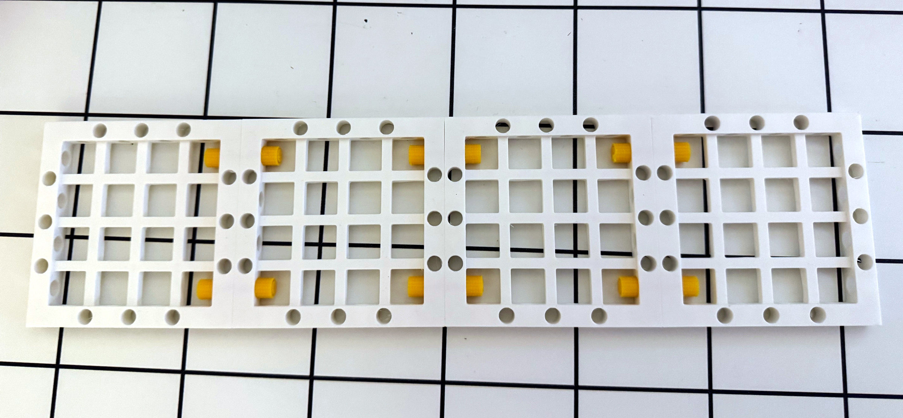
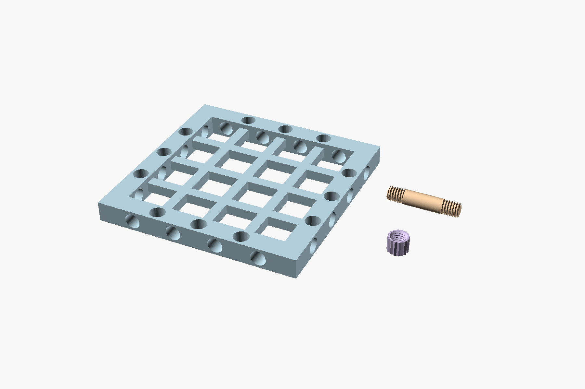

# Modular shower grid

Four printed 80 × 80 mm grid panels have been assembled in a row with printed
threaded studs and knurled nuts. The assembly was photographed by November 1,
2026. The photograph records the physical assembly; it does not establish load
capacity or performance in a wet bathroom.

The [original HEIC](photos/original.heic) is preserved. The JPEGs use modest
crop, contrast and colour adjustments; the checked table remains visible.

## Inspection and print files

- [Pastel inspection scene](inspection.scad): open in OpenSCAD preview (F5) to
  see the three parts on a common plane in different colours.
- [Pastel inspection 3MF](parts/inspection-pastel.3mf): the same three-part
  layout with colours stored as 3MF materials. This is a viewing scene.
- [Combined inspection STL](parts/inspection-layout.stl): all three separated
  parts in one mesh file. STL does not store the OpenSCAD preview colours. The
  stud lies on its side for display; use the print project or individual parts
  for slicing.
- [Grid STL](parts/grid80.stl), [stud STL](parts/stud28.stl), and
  [knurled nut STL](parts/knob6.stl).
- [Bambu Studio project](parts/print-project.3mf): one of each part, yellow
  PolyLite PETG, the recorded separate brim and infill settings.
- Parametric sources: [grid](src/grid.scad) and [fasteners](src/fasteners.scad).

The grid has an 8 mm square outer frame, a centred 4 mm grid and 6 mm nominal
holes. The latest stud is 6.5 + 15 + 6.5 = 28 mm long; the knurled nut is 6 mm
high and 8 mm in outside diameter. The combined inspection file preserves this
latest geometry; the photograph documents the assembled physical panels, not a
measurement of the exact fastener revision inside each joint.

## Reproduction and licensing

The inspection STL was exported with the workshop's `export_stl` on November 1,
2026. Its three disconnected components are arranged for viewing and are not
one connected printable assembly. The accompanying source imports the archived
STLs so the inspection geometry matches the recorded printable parts.

The fastener source and dependent geometry use Dan Kirshner's `threads.scad`,
version 2.7, licensed under GPL-3.0-or-later. The original notice is preserved
in [the library](src/lib/threads.scad); see the workshop's
[third-party notices](../../THIRD_PARTY_NOTICES.md) and
[license text](../../LICENSES/GPL-3.0-or-later.txt).
