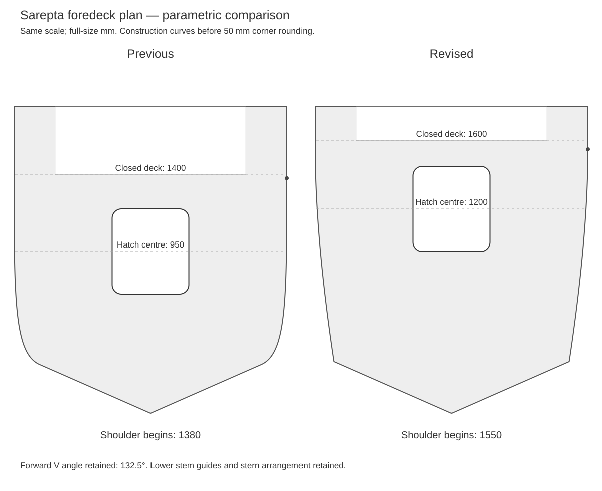

# Bow plan and foredeck proportion review — 2026-10-23

## What was wrong

The previous cubic had three control-point Y coordinates at full half-beam:
`[[286,650],[352,800],[670,800],[1380,800]]`. Most visible narrowing was
concentrated close to the forward V. A mathematically convex shoulder did not
mean that its narrowing distribution matched the reference. The bow looked
like a rectangle followed by a short triangle. Foredeck length 1400 and hatch
centre 950 had been estimates; they were not recovered factory dimensions.

## Drawings and photographs revisited

Read the complete factory passport again, particularly appendix 2 plan, the
1974 body plan and general arrangement, and the already preserved kit gallery
and the user's new near-top photo. The body plan describes hull sections; it
does not locate the hatch or the cockpit opening. The passport plan is a
schematic general arrangement, with no dimensioned deck contour/offset table.
Frame labels are not a calibrated spacing diagram.

The plan scan is about 907 pixels long and 330 wide between manually selected
outer datums. The front cockpit/dashboard/windscreen boundaries are ambiguous
within roughly x=740..790. Normalising only by overall length gives about
1300..1560 for that broad region, before scan/landmark uncertainty. This does
not prove that the previous 1400 was dimensionally wrong.

The kit photo is different: with apparent beam about 510 pixels, tip near
y=660, forward opening near y=170..190 and hatch centre near y=295..310,
beam-only normalisation suggests a foredeck around 1470..1540 and hatch centre
around 1100..1150. Perspective, deck height and kit fidelity are uncorrected.
These are visual ratios, not independent measurements of the real boat.

**The hatch positions disagree between sources.** Approximate passport
landmarks place its centre roughly 620..720 from the bow using overall-length
normalisation. The kit photo suggests a substantially more aft centre. The
new 1200 follows the user-selected visual target and must not be attributed
to the passport. Neither drawing scaling nor the kit establishes an exact
production-variant hatch position.

See [recorded landmarks and decisions](plan-review/landmarks-and-decisions.json).
All pixel landmarks are approximate manual observations. The new 1600 closed
foredeck is a deliberate slightly longer visual reconstruction, not a claimed
factory callout or exact tracing of either image.

The kit's hatch-centre/deck-length ratio is approximately 0.74. Preserve that
ratio after choosing a slightly longer 1600 deck: the selected centre is 1200
(0.75), rather than treating the uncorrected 1100..1150 image-normalised
estimate as an independently exact coordinate.

## Coordinated geometry revision

| Feature | Previous | Revised | Basis |
| --- | --- | --- | --- |
| Closed upper foredeck / dashboard X | 1400 | 1600 | Visual reconstruction; slightly longer than the kit's uncorrected beam-normalised estimate |
| Hatch centre from foremost tip | 950 | 1200 | User-selected kit-photo target, not passport-derived |
| Hatch opening | 500 x 450 | 500 x 450 | Existing estimated size retained |
| Full-beam shoulder end X | 1380 | 1550 | Starts narrowing just ahead of the new cockpit front |
| Forward V included angle | 132.501 degrees | 132.501 degrees | Previously accepted photographic target retained |
| Forward well wall X | 4000 | 4000 | Accepted stern/well length retained |
| Upper opening length | 2600 | 2400 | Longer deck extends over the forward interior |
| Footwell reach | 300 | 200 | Estimated layout adjusted; lower forward wall X=1400 |
| Interior length including footwell | Previously not aligned with this datum | 2600 | Interprets published envelope as interior including leg space; datum interpretation is not factory-certified |

New shallow shoulder: `[[303.6,690],[600,735],[1100,800],[1550,800]]`.
Its forward join to the steeper V is intentional. Trim the 50 mm normal
inward offset at its intersection with the forward V inset; using an
untrimmed normal at the knuckle would move the sheer ahead of the V and
could invert the bow strip. The chine/stem guides are unchanged.

The raised pad extends to X=1550; straight 560-long deck beads move with the
hatch. Dashboard pockets and upper side returns move with the dashboard.
The transom, well, frame definition and horizontal side ridges are retained.
The accepted overall envelope remains 4600 x 1600 with a 750 deck datum.

This is a parametric construction diagram before local corner rounding, not
a render of a historical mesh. The actual deck receives nominal 50 mm corner
rounding while a separate forward triangle preserves the sharp tip. A 0.03
model-mm overlap covers the loft cap to avoid coplanar STL slivers.
The old/new actual STLs remain in separate immutable release folders.

## Remaining limits

A measured full deck plan or a survey of the applicable production variant
is still required to resolve these conflicting hatch/deck references.
The revision improves the requested proportions; it does not create
factory-accurate missing dimensions. Bow fairness, uniform offsets and
solid/cavity checks are necessary independent checks, not evidence of scale fidelity.
