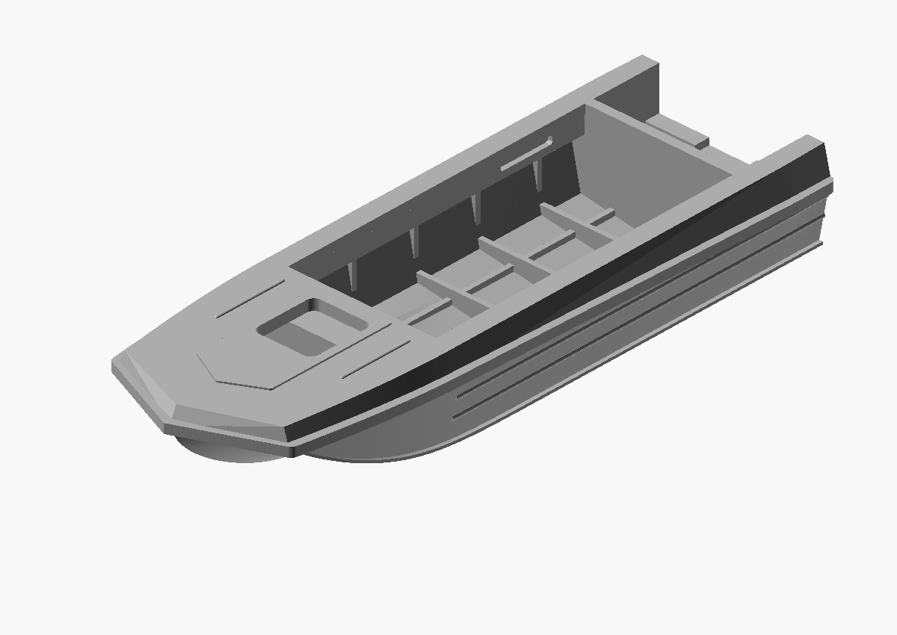

# Sarepta — hull reconstruction and reference archive

Start here. This project preserves the printable hull, the evidence used to
reconstruct it, and the unsuccessful and successful intermediate versions.
All dimensions in research notes are prototype millimetres unless stated otherwise.

## Current state — 2026-10-30

The latest [serviceable dashboard release](releases/2026-10-28_serviceable-dashboard/README.md)
contains four STL parts: reinforced lower hull, internally revised upper cover,
removable dashboard with footwell shelf, and lift-out stop bar. The projecting
lower chine strip is removed; upper protective rim and side corrugations remain.
Front locating sockets have full-height webs and sloped roots. The dashboard
slides aft after removing the stop bar, even with the upper cover glued.
All four meshes, 33 material probes and sampled movement/contact checks pass.
The owner reported an excellent print on 2026-10-30 and nominated this variant
as [release candidate 0.1](release-candidates/0.1/README.md). **The successful
print was rotated lengthwise along the bed, not diagonally.** Archived 3MFs still
store the earlier 45-degree preparation; reorient and re-slice to reproduce the
successful placement. Exact part coverage and assembled fit are not confirmed.
Open [the separated view](inspect_split.scad).

The current editable model includes three bow stems, paired tunnels, a foredeck
hatch, continuous protective rim, inward-sloping upper belt and shallow foredeck
relief. It is **a reconstruction, not a dimension-certified factory replica**.
The cabin and motors remain separate future work. The 80 mm trial retains
printable wall thickness rather than scaling the metal plate thickness literally.

The side/deck datum is now 750 mm including the reverse upper belt. The model
uses the coherent early 4600 x 1600 envelope, the passport's 375 mm motor seat
and the published 2600 x 1280 cockpit envelope; longitudinal positions remain
reconstructed. Internal floor/side frames, longitudinal stiffeners, separate
bow locker, a raised motor well, side corrugations and chine flanges are included.
See [transom and framing decisions](TRANSOM_AND_FRAMING.md) and
[pending corrections](PENDING_CORRECTIONS.md) for remaining estimates.

The [accepted one-piece parent](releases/2026-10-23_bow-plan-proportions/README.md) includes
both exact binary STL sizes: 80 x 27.826 x 13.261 and
170 x 59.130 x 28.179 mm. Both pass edge/vertex topology checks; physical
printing is untested. Heights include the small embossed deck details.

The two side corrugations now remain horizontal and run from an estimated
X=1600 to the transom at X=4600, with flat forward ends, following the user
photographs. Their heights of 280 and 425 remain visual estimates.

The latest interior revision adds a stepped front boundary with leg space,
wider cabin landing strips covering the unchanged frame tips, four backed
storage pockets and motor-well scuppers. Deck beads are straight, shorter
and shallower. Read the [interior evidence audit](INTERIOR_RESEARCH.md) for
source-backed features and estimated dimensions. Views are neutral grey.

The latest plan review redistributes the bow narrowing over a long shallow
shoulder before the steeper forward V. The closed upper deck is 1600 and the
hatch centre 1200 from the tip; the well remains at 4000. These are selected
reconstruction values. The kit and passport schematic disagree on hatch
placement; see [bow plan review](BOW_PLAN_REVIEW.md) for recorded image
landmarks, uncertainty and a construction comparison.

## Evidence and decisions

- [Dimensional evidence audit](DIMENSION_RESEARCH.md): explicit values, conflicts,
  unmeasured details, archive leads and implications for the current model.
- [Dimensions as CSV](DIMENSIONS.csv): machine-readable companion to the audit.
- [Source catalogue and attribution](reference/SOURCES.md): where every group
  of documents, images and tutorials came from, and how it was used.
- [Reference image index](reference/README.md): the most useful views and documents.
- [Pending corrections and assumptions](PENDING_CORRECTIONS.md): remaining modelling
  work; a proposed value is not silently promoted to a factory measurement.
- [Development log](DEVELOPMENT_LOG.md): the complete earlier chronological account,
  including historical checks and slicing estimates. Earlier claims are historical;
  the newer dimensional audit takes precedence.

## Models and history

- [Main OpenSCAD source](sarepta_hull.scad): default overall length 170 mm.
- [80 mm entry point](sarepta_hull_80mm.scad).
- [Bow and plan regression checks](verify_bow.scad).
- [STL release history with pictures](releases/README.md): the earlier 80 mm
  milestones and the latest 170 mm export, preserved byte-for-byte, with renders made from their actual meshes.
- [Latest archived STL stage](releases/2026-10-23_bow-plan-proportions/README.md):
  long shallow bow shoulders, a longer foredeck and coordinated hatch placement; remaining estimates are explicit.
- `history/`: accepted parametric snapshots before subsequent revisions.
- `previews/`: working renders; release-specific mesh renders are under `releases/`.

## Agent workflow

Before changing the hull, read [AGENTS.md](AGENTS.md) and the project-local
[boat-hull-reconstruction skill](skills/boat-hull-reconstruction/SKILL.md).
The skill packages the methods and lessons from this project; it is not globally
installed. Its supporting notes distinguish McNeel guidance from original
OpenSCAD adaptations and rejected external role instructions.

Export newly generated STLs with the repository `export_stl` tool and the
conversation-authorized export base. Existing historical exports are preserved,
not regenerated. During design, provide STL/OpenSCAD views; Bambu preparation is
performed when requested.

## Integrity and provenance

`reference/SHA256SUMS` covers every preserved reference file.
`releases/SHA256SUMS` covers historical meshes, source snapshots, metadata and renders.
Run `python3 tools/verify_archive.py` after copying or restoring the archive.
Source URLs, capture dates and hashes are preserved locally. Third-party
attribution is recorded in [ATTRIBUTION.md](ATTRIBUTION.md); no blanket license
is assigned to reference scans or photos.

## Upper-deck lightening comparison

The [pocket study](releases/2026-10-27_upper-pocket-comparison/README.md) is
archived as a comparison, not the current model. With identical slicing
settings, pockets save only 0.48 g (2.92%) and add 2 min 39 s. The accepted
unpocketed horizontal upper remains recommended; physical strength of the
pocket candidate has not been tested.

## Prepared printing project — 2026-10-28

[The corrected white-filament printing project](print-projects/2026-10-28_serviceable-white/README.md)
contains two A1 mini plates with all four parts and four locating pins: 0.16 mm,
three walls and ordinary 15% Grid. White Polymaker PolyTerra PLA is embedded. Estimated total 4 h 46 min and 73.70 g,
including supports and adhesion material. A successful lengthwise print was
reported on 2026-10-30; see [candidate 0.1](release-candidates/0.1/README.md) for
the crucial difference from the archived diagonal layout.

Latest design study: [2026-10-31 lightweight open deck](releases/2026-10-31_lightweight-open-deck/README.md)
— one roof skin, open ribs, small glue locators, single panel and higher rear
transom. Digitally checked, physically untested; candidate 0.1 remains archived.
