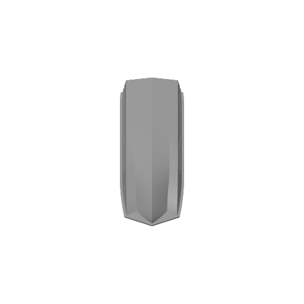
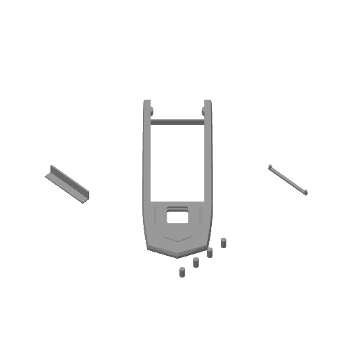

# Sarepta 170 mm — sliced A1 mini project, 2026-10-28

One Bambu project with two plates, prepared from the four accepted serviceable
STL parts plus four 4 x 8 mm locating pins. No printer dispatch was performed.
Full profile snapshots, source hashes, orientations and verification accompany
the actual sliced project. Bambu Studio 02.07.01.62 produced the file.

## Process

A1 mini, 0.4 mm nozzle, Generic PLA in grey, textured PEI bed 55 C and nozzle
220 C from the preserved Generic PLA profile. Layer height 0.16 mm, three wall
loops, ordinary 15% Grid, five top and four bottom shell layers, 3 mm outer
brim. No 100% infill overrides: small pins are naturally dense from perimeters.
Automatic tree supports on the hull and cover only, build-plate only, 0.16 mm
Z separation and 0.35 mm XY separation. Small parts have supports disabled.

- Plate 1: hull inverted on the horizontal glue rim and rotated 45 degrees in
  plan for bed margin. Broad bed contact stabilizes the reinforced bow. Remove
  interior supports before assembly. Estimate 3 h 57 min 49 s and 50.90 g.
- Plate 2: cover glue-plane down and rotated 45 degrees; panel on its shelf;
  locking bar head down with pegs up; four upright locating pins in free corners.
  Small supports protect the relieved underside edge of the cover.
  Estimate 55 min 59 s and 18.86 g.
- Total estimate: 4 h 53 min 48 s, 69.76 g including supports and adhesion.

All eight objects are included and not skipped. Both plate bounding boxes fit
inside 180 x 180 mm, all recorded mesh-repair counters are zero, and saved
settings confirm the requested layer/walls/infill. Source STL files are unchanged.
Physical strength and fit are untested; dry-fit before gluing. Keep the dashboard
and stop bar removable. The CLI also emits inherited Generic PLA vitrification
and unsupported-timelapse profile notices; actual G-code uses the profile's
55 C textured-bed setting. No outside-bed or floating-cantilever warning remains.

