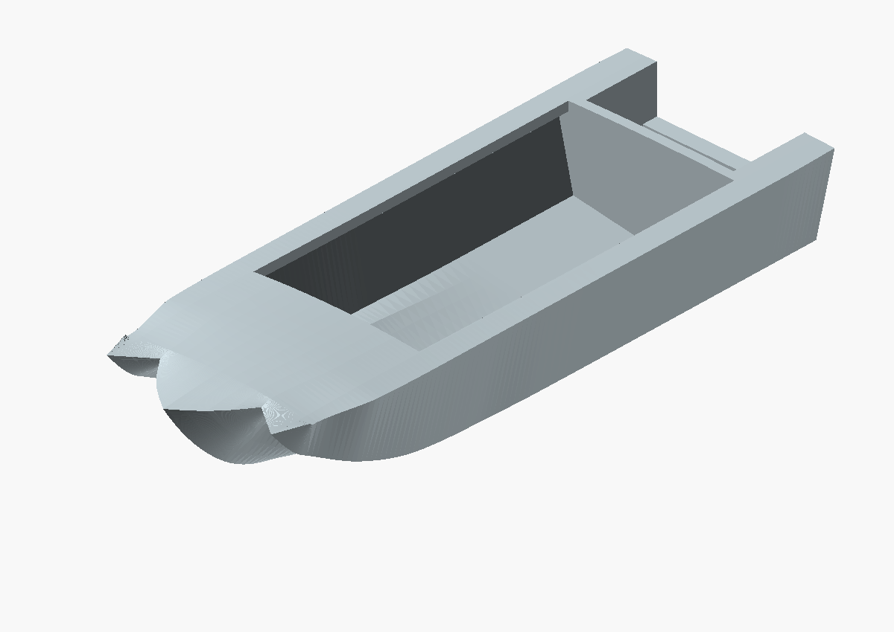
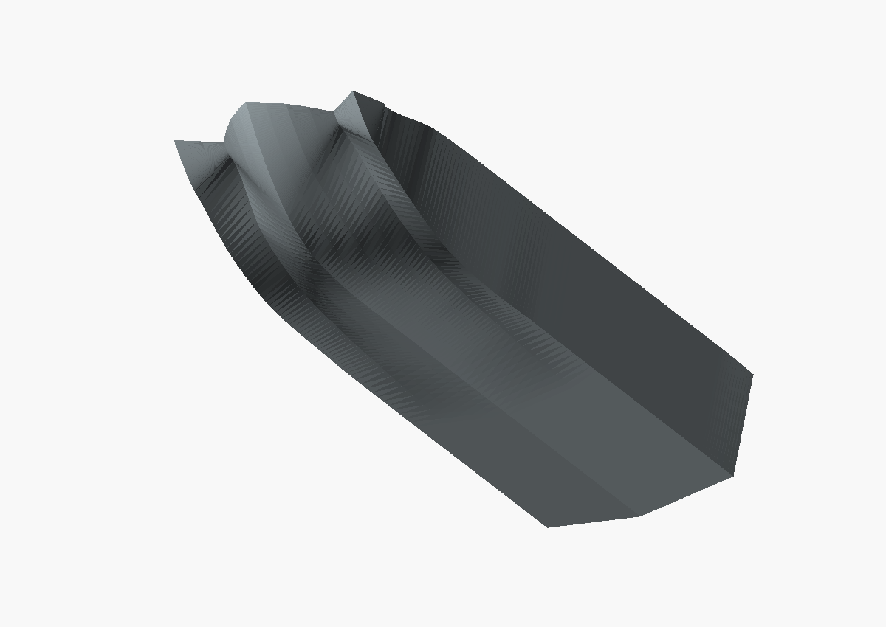
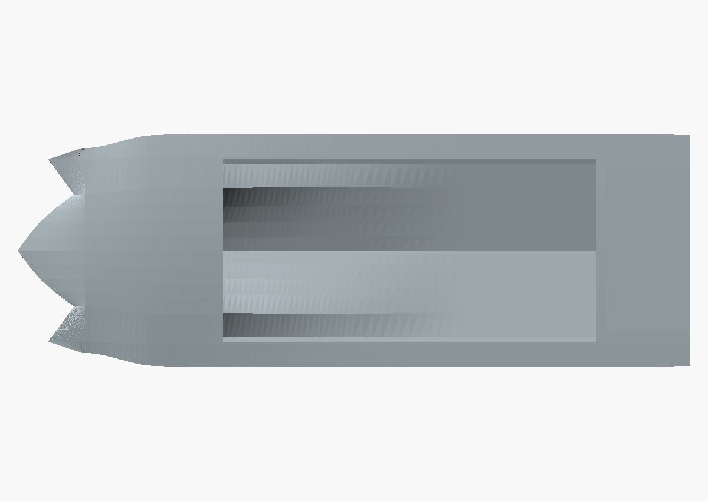

# Continuous stem tangents

Original export date: 2026-10-21. Preserved model length: **80 mm**.

Replaced short endpoint offsets with independent Hermite profiles and smoother joins.

## Limitations

Remaining curvature dents and scalloped foredeck perimeter; superseded.

This is a historical reconstruction, not a dimension-certified replica or a
record of a successful physical print. See [the dimensional audit](../../DIMENSION_RESEARCH.md)
and [pending corrections](../../PENDING_CORRECTIONS.md).

## Files and provenance

- [Original STL](2026-10-21_sarepta_hull_80mm_continuous_bow.stl): byte-for-byte copy of the surviving export.
- [OpenSCAD viewer](view.scad): imports this exact STL.
- [Metadata](metadata.json): original path, SHA-256, status and source availability.
- Source snapshot: not preserved for this stage; the STL itself is the authoritative surviving artifact.

The renders below import this archived STL directly with common camera settings
across milestones. They do not use the current editable source.

## Current inspection of the archived file

See [mesh-report.json](mesh-report.json). Bounds: 80.0000 x 27.8261 x 13.9478 mm; 8808 triangles. Basic mesh checks: pass. This check does not certify shape accuracy or minimum wall thickness.
