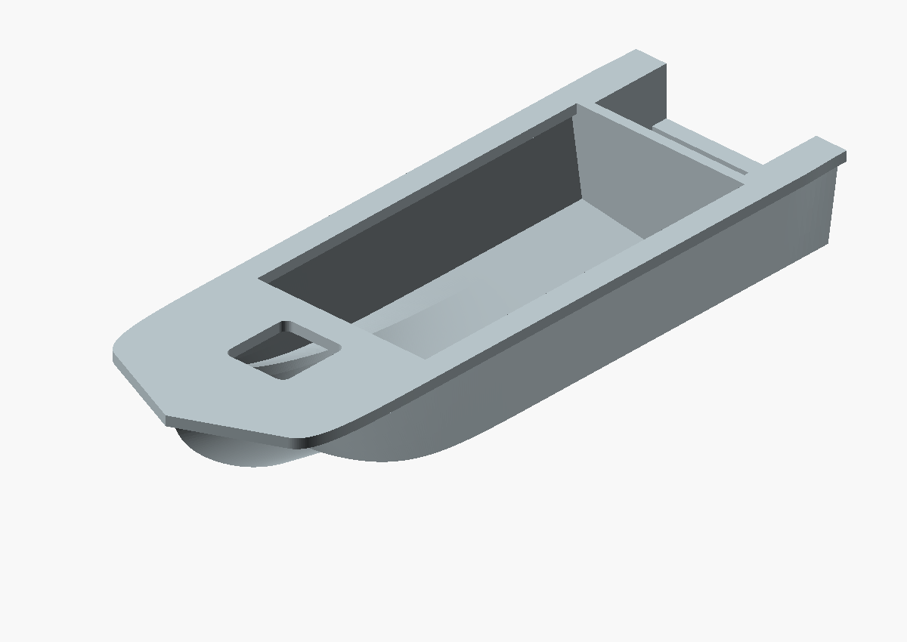
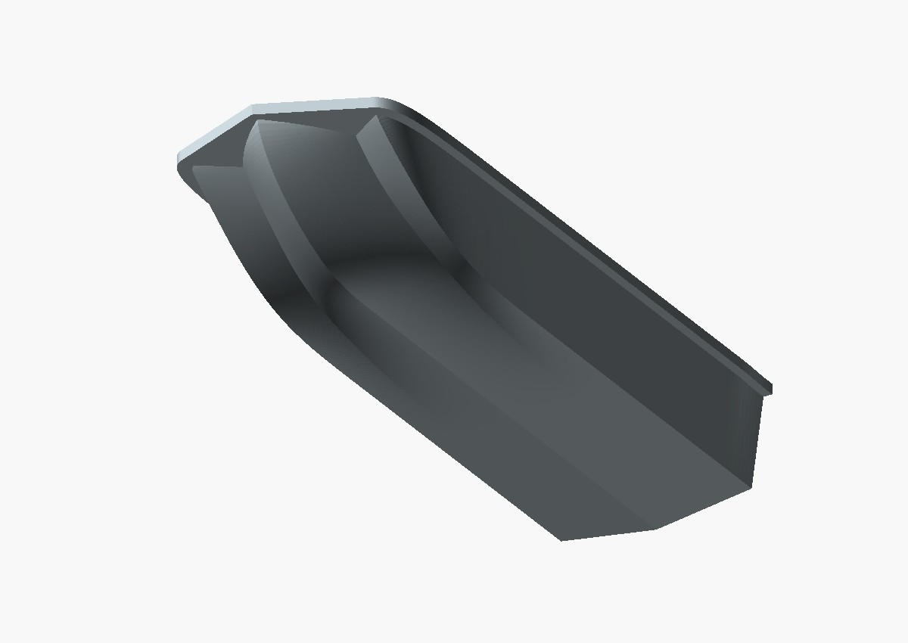
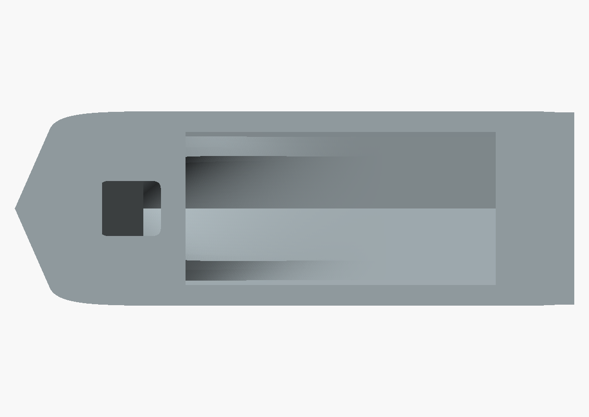

# Hatch, fair side arcs and continuous rim

Original export date: 2026-10-22. Preserved model length: **80 mm**.

Added the hatch opening, removed the S-shaped shoulder and continued the protective rim around the bow and sides.

## Limitations

Flat upper deck omitted the reverse-flared upper belt; 50 mm prototype rim and hatch sizes were estimates.

This is a historical reconstruction, not a dimension-certified replica or a
record of a successful physical print. See [the dimensional audit](../../DIMENSION_RESEARCH.md)
and [pending corrections](../../PENDING_CORRECTIONS.md).

## Files and provenance

- [Original STL](2026-10-22_sarepta_hull_80mm_hatch_fair_rim.stl): byte-for-byte copy of the surviving export.
- [OpenSCAD viewer](view.scad): imports this exact STL.
- [Metadata](metadata.json): original path, SHA-256, status and source availability.
- Source snapshot: [source.scad](source.scad) and [80 mm entry](source-80mm.scad).

The renders below import this archived STL directly with common camera settings
across milestones. They do not use the current editable source.

## Current inspection of the archived file

See [mesh-report.json](mesh-report.json). Bounds: 80.0000 x 27.8261 x 13.0435 mm; 61898 triangles. Basic mesh checks: pass. This check does not certify shape accuracy or minimum wall thickness.
