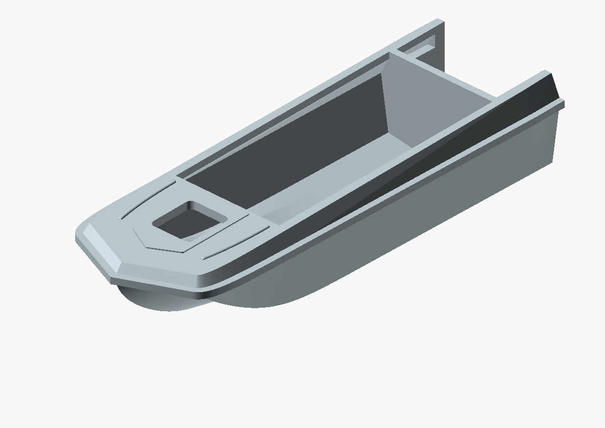
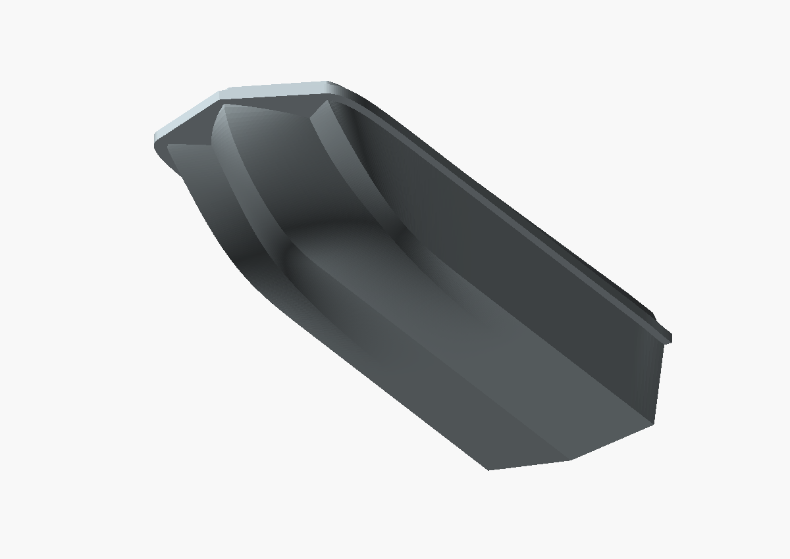
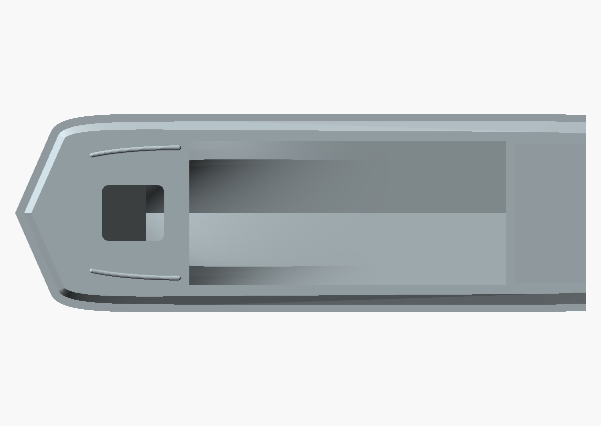

# Upper belt and shallow foredeck relief

Original export date: 2026-10-22. Preserved model length: **80 mm**.

Added inward-sloping upper sides, a pointed raised pad around the hatch and two shallow rounded ribs.

## Limitations

CURRENT GEOMETRY, AWAITING DIMENSION CORRECTION: seam was incorrectly placed at 750 mm before adding the upper belt, giving up to 950 mm prototype height. Transom remains 400 rather than passport 375 mm.

This is a historical reconstruction, not a dimension-certified replica or a
record of a successful physical print. See [the dimensional audit](../../DIMENSION_RESEARCH.md)
and [pending corrections](../../PENDING_CORRECTIONS.md).

## Files and provenance

- [Original STL](2026-10-22_sarepta_hull_80mm_upper_belt_relief.stl): byte-for-byte copy of the surviving export.
- [OpenSCAD viewer](view.scad): imports this exact STL.
- [Metadata](metadata.json): original path, SHA-256, status and source availability.
- Source snapshot: [source.scad](source.scad) and [80 mm entry](source-80mm.scad).

The renders below import this archived STL directly with common camera settings
across milestones. They do not use the current editable source.

## Current inspection of the archived file

See [mesh-report.json](mesh-report.json). Bounds: 80.0000 x 27.8261 x 16.5217 mm; 52056 triangles. Basic mesh checks: pass. This check does not certify shape accuracy or minimum wall thickness.
