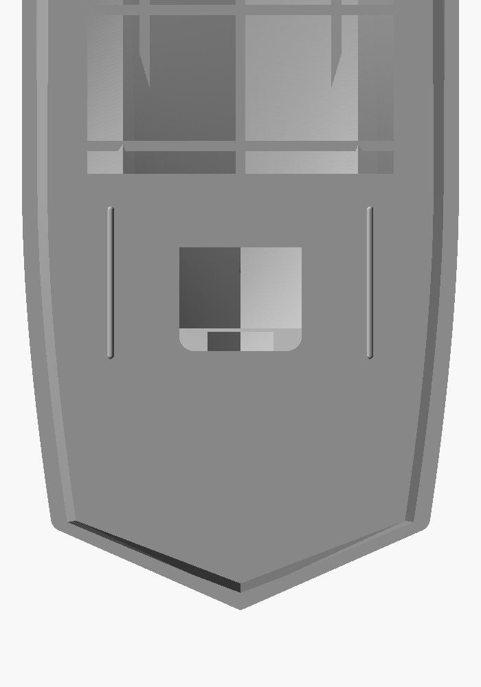
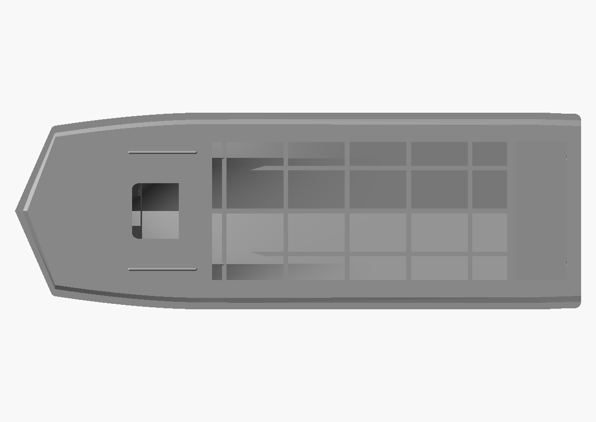
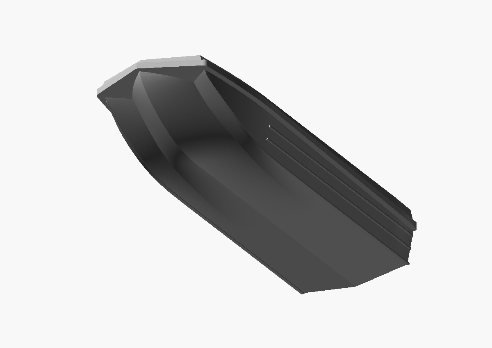
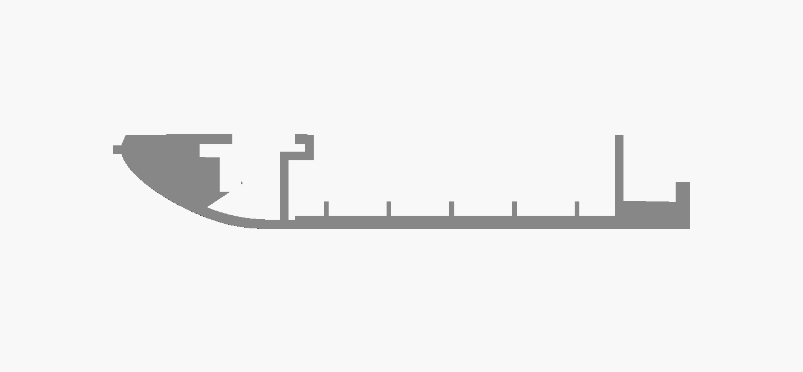

# Bow plan and foredeck proportions — 2026-10-23

[Drawing/photo review and source conflicts](../../BOW_PLAN_REVIEW.md).
The new user images and manual landmarks are preserved. The plan comparison
is a native parametric vector diagram, explicitly separate from STL renders.

## Coordinated changes

- Long, shallow convex shoulder begins at X=1550, just forward of the
  new dashboard at X=1600; the steeper 132.501-degree forward V is retained.
- Shoulder inset is trimmed where it meets the forward V inset, preserving
  normal rim width without crossing the side chine.
- Closed foredeck: 1400 to 1600. Hatch centre: 950 to 1200; opening 500 x 450.
- Raised pad extends to 1550; shorter straight beads move with the hatch.
- Well remains at 4000. Upper opening length becomes 2400; a 200-forward
  footwell gives a 2600 interior reference to the accepted well wall. This is
  an interpretation of the interior datum, not a verified factory section.
- Lower guide and frame definitions are byte-for-byte unchanged from the
  preceding source. Side panels and their cavity follow the new sheer grid.

The passport schematic and secondary kit differ in hatch position. New
positions follow the user-selected visual target and remain estimates.
Do not claim a dimensioned factory deck plan or offset table was recovered.

The deck shoulder corners have nominal 50 mm rounding; the foremost tip
remains sharp. A 0.03 model-mm cap overlap avoids coincident loft/sheet facets.
The final hatch is at 75 percent of the selected foredeck length, close to
the reference photo's approximate relative placement.

## Files and verification

- [80 mm binary STL](2026-10-23_sarepta_hull_80mm_bow_proportions.stl): 80.000 x 27.826 x 13.261 mm.
- [170 mm binary STL](2026-10-23_sarepta_hull_170mm_bow_proportions.stl): 170.000 x 59.130 x 28.179 mm.

The repository exporter generated both meshes; archived copies are byte-for-byte
identical. View wrappers import those meshes; source snapshots and regressions
are preserved. No post-export repair.

Both exact binary exports pass edge pairing, vertex links, nonzero faces,
positive volume and single-component checks. Saved material samples pass for
footwell, stepped walls, ceiling, hatch space, cockpit and side landing strips.
Curve convexity, aft continuity, trimmed uniform rim, clear chine/sheers and
coordinated layout assertions pass. Fixed print thickness still produces
different small internal openings between sizes. Physical printing and full
minimum-wall/self-intersection certification remain unverified.

