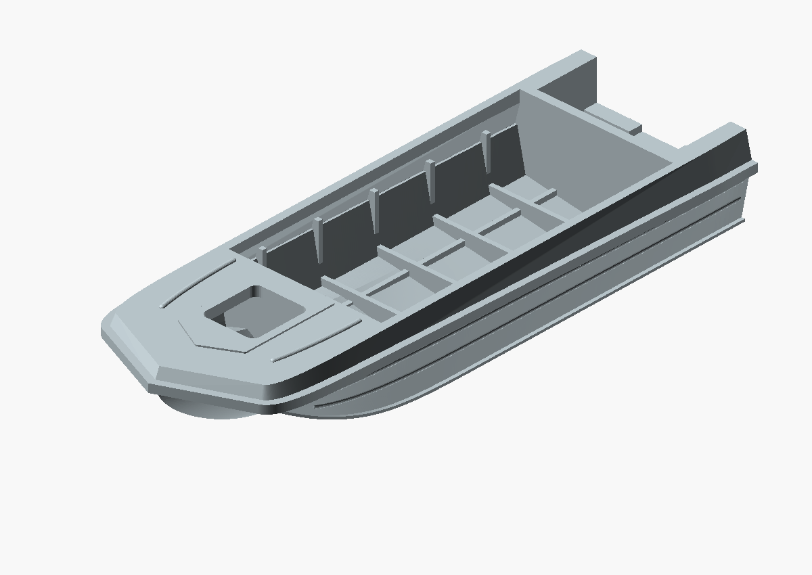
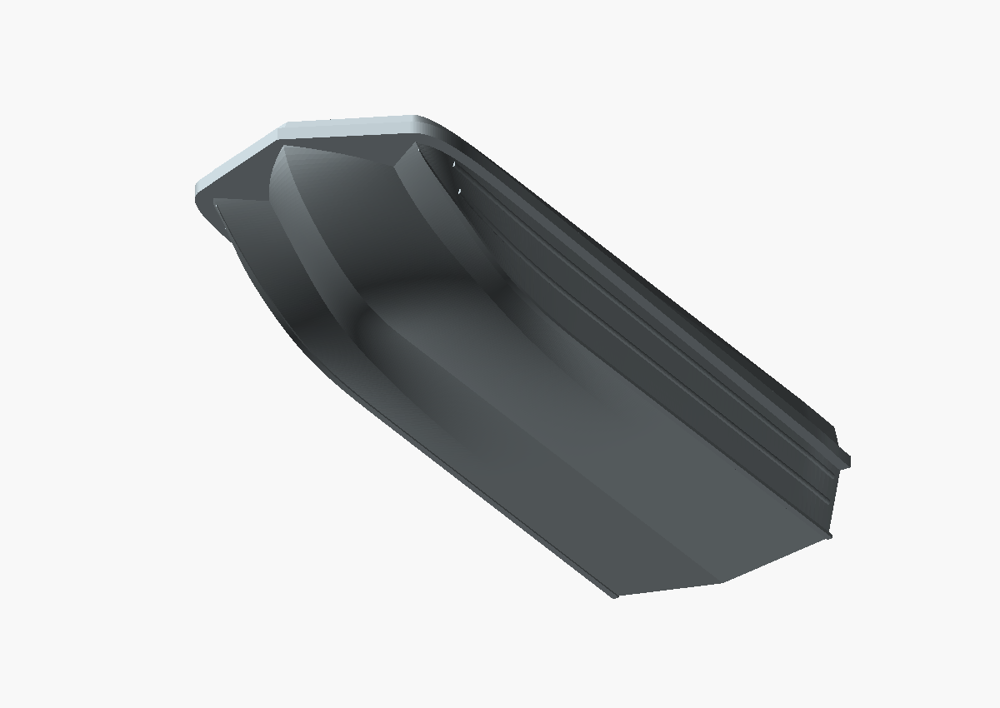
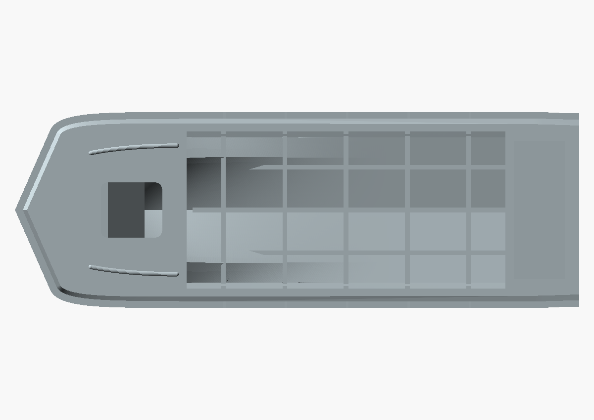
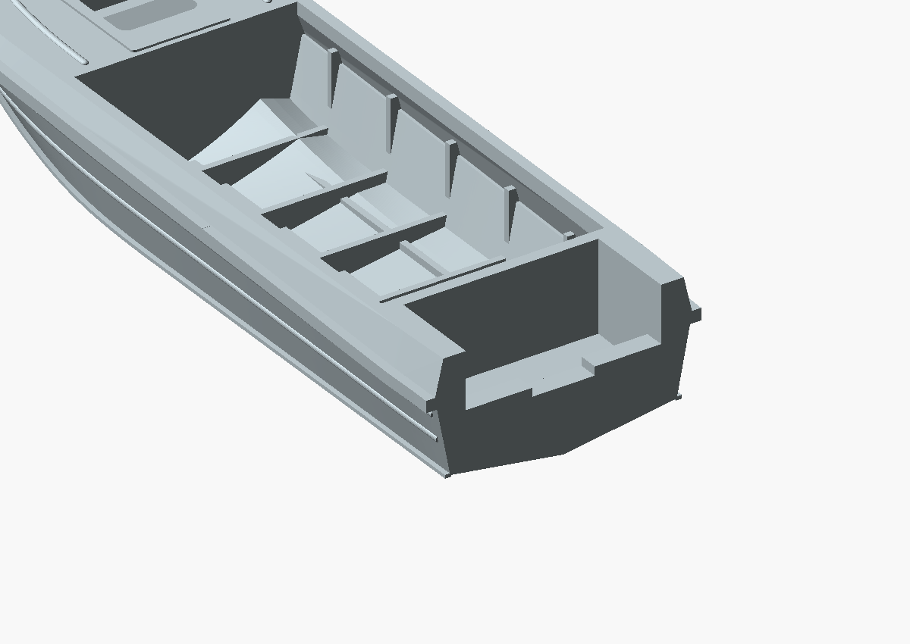
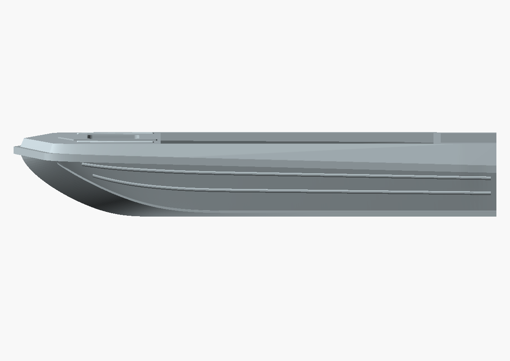

# Corrected dimensions and framing — 2026-10-23

The preceding archive checkpoint was committed and pushed as `cc04d8c`
before these geometry changes, as requested.

## Models

| Version | Actual mesh bounds, mm | Triangles |
| --- | --- | --- |
| [80 mm STL](2026-10-23_sarepta_hull_80mm_dimensions_framing.stl) | 80.000 x 27.826 x 13.299 | 65306 |
| [170 mm STL](2026-10-23_sarepta_hull_170mm_dimensions_framing.stl) | 170.000 x 59.130 x 28.261 | 66322 |

`view.scad` imports the exact 80 mm binary STL; `view-170mm.scad` imports
the full version. `source.scad` and `source-80mm.scad` preserve this revision.
Both meshes were exported with the repository exporter, `--export-format binstl`,
then copied byte-for-byte. No mesh repair or post-export geometry modification.

## Changes and evidence

See [transom and framing decisions](../../TRANSOM_AND_FRAMING.md) and
[dimensional audit](../../DIMENSION_RESEARCH.md). The main deck datum is now
750 full-size millimetres; the shallow relief extends slightly above it.
The reverse belt occupies part of the published side height instead of being
added above it. Bow tips were re-faired while preserving their lower aft joins
and the accepted 132.501-degree plan target.

The motor well has its own raised, gently draining floor; the outer bottom
retains the V section. The engine seat is 375; estimated shoulders 425.
Bow locker is separated from the published 2600 x 1280 cockpit opening.
Five transverse frames, three longitudinal stiffeners, three transom knees,
two side corrugations per side and 30 mm chine spray flanges were added.
The model retains its continuous protective rim and hatch/pad/rib features.

## Verification and limits

Both exact binary exports pass paired-edge, vertex-link, nonzero-face,
positive-volume and single-component checks. Euler characteristic is 2
(no unintended handles); see the JSON reports. Guide curvature, aft continuity,
plan angle, rim offsets and dimensional datums pass `verify_bow.scad`.
A new vertex-link check caught a point pinch missed by the earlier edge-only
checker; overlapping surfaces and continuous flange geometry corrected it.

Actual STL views are shown below. No physical print or minimum-wall/self-
intersection certification has been performed. Frame positions/profiles,
upper-belt dimensions, well-floor angle, transom rake, notch width/depth,
hatch and relief details remain reconstruction estimates. Thin model features
are enlarged for printing. Cabin, hatch lid and motors are future separate parts.

