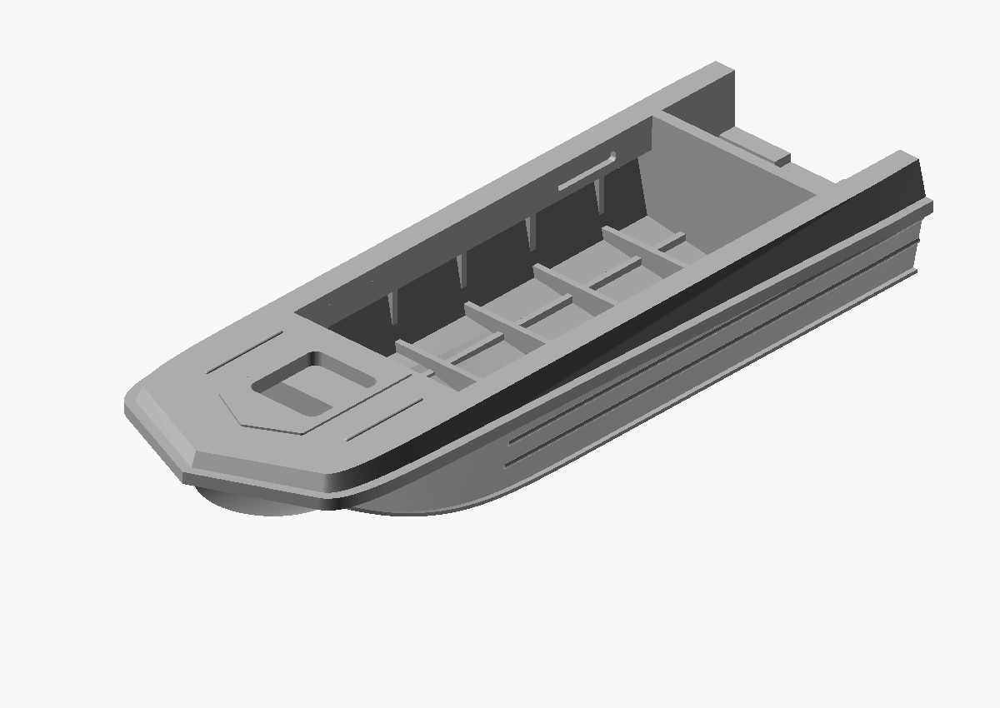
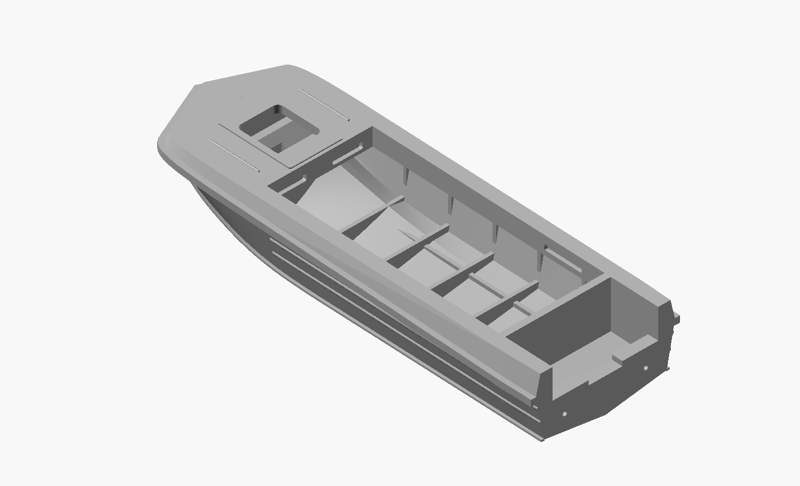
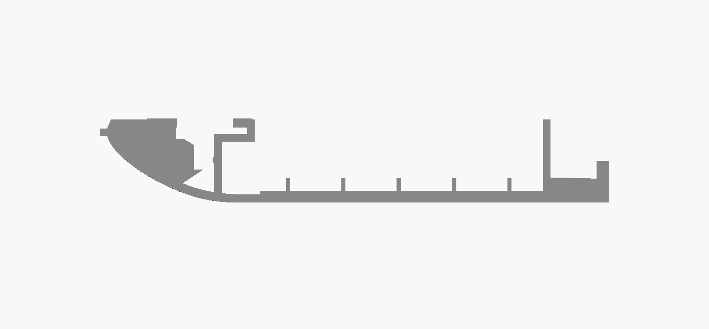
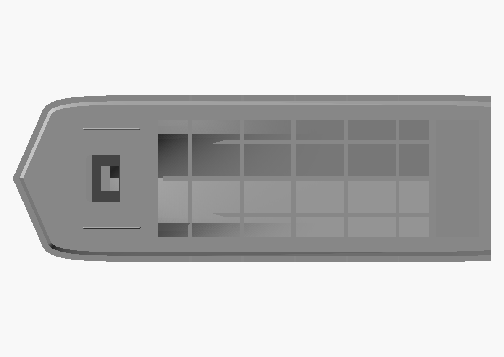
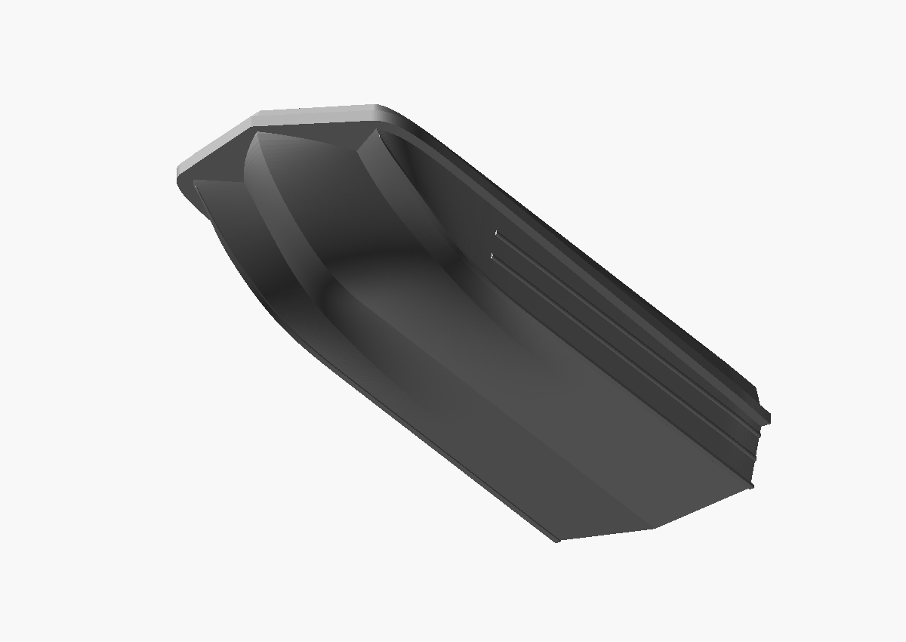

# Footwell, cabin landings and interior details — 2026-10-23

[Detailed research and source audit](../../INTERIOR_RESEARCH.md).
The latest user screenshots and additional first-hand source material are
preserved with provenance in the reference archive.

## Geometry changes

- Upper dashboard face is nominally 200 full-size mm high. A horizontal
  ceiling at Z=550 extends 300 forward to a lower wall at X=1100. This creates
  leg space beneath the dashboard without opening the locker into the cockpit.
  These section dimensions are reconstructed, not factory callouts.
- Clear a residual internal ledge below the hatch so the lower locker remains
  accessible; the clearance cut remains above the central bow bottom and
  ahead of the stepped wall. This is not an opening in the hull skin.
- Widen the upper landing strips inward by 80 per side, making the upper
  opening 1120. The published 1280 dimension remains an interior-envelope
  reference, not a claim about this reconstructed upper opening.
- Existing `framing_members()` definition is byte-for-byte unchanged.
- Add two backed dashboard pockets and one backed side-return pocket per side,
  with >=0.55 model-mm backing, plus two estimated motor-well drains.
- Replace curved deck beads with straight 560-long, 24-wide, 10-high beads
  parallel to the centreline, slightly longer than the 500-long hatch.
- Neutral-grey geometry and Tomorrow render scheme; STL itself stores no colour.

## Models and validation

- [80 mm binary STL](2026-10-23_sarepta_hull_80mm_interior_detail.stl): 80.000 x 27.826 x 13.261 mm.
- [170 mm binary STL](2026-10-23_sarepta_hull_170mm_interior_detail.stl): 170.000 x 59.130 x 28.179 mm.

`view.scad` and `view-170mm.scad` import the exact meshes. `cutaway.scad`
cuts the archived mesh for inspection. Parametric snapshots and regression
checks are preserved alongside them. No mesh repair/post-export modification.

Both binary STLs pass edge-pairing, vertex-link, nonzero-face, positive-volume
and single-component checks. Eight independent material samples in each mesh
confirm open footwell/cockpit/hatch spaces and solid partition/ceiling/landing
locations; see `interior-checks-80mm.json` and `interior-checks-170mm.json`.
Sampling is not a proof of full cavity connectivity or minimum thickness.

Euler characteristics differ (-22 at 80 mm and -4 at 170 mm): fixed print
wall/profile thickness intersects the returns and framing differently,
in addition to the new scuppers. Do not interpret this as literal scaling of
every small internal opening. Both meshes have one closed orientable boundary
component and no pinched vertices; no disconnected enclosed pocket remains.

Bow curvature, rim offsets, level side ridges, height datums and new interior
placement assertions pass at both supported sizes. No physical print or full
minimum-wall/self-intersection check has been performed.

Repeat saved material samples with `../../tools/verify_material_samples.py`
and the corresponding STL/check JSON (NumPy required). These point checks
complement the topological checker and visual section; they do not certify
complete connectivity or original factory dimensions.
