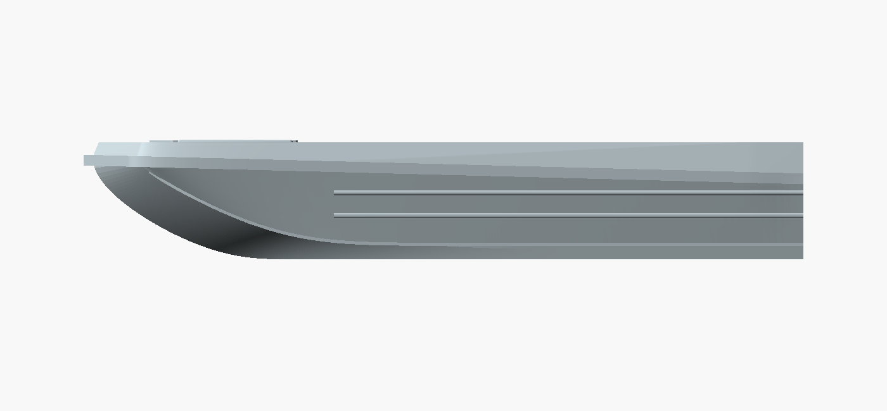
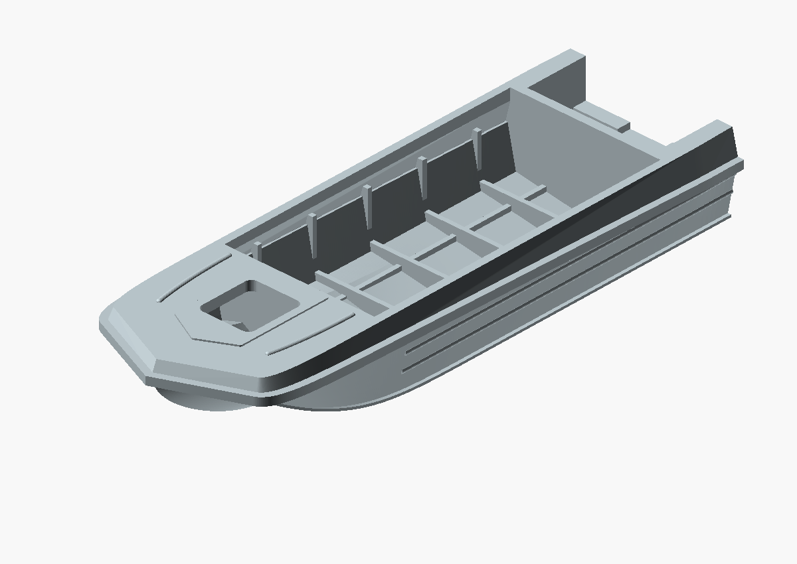
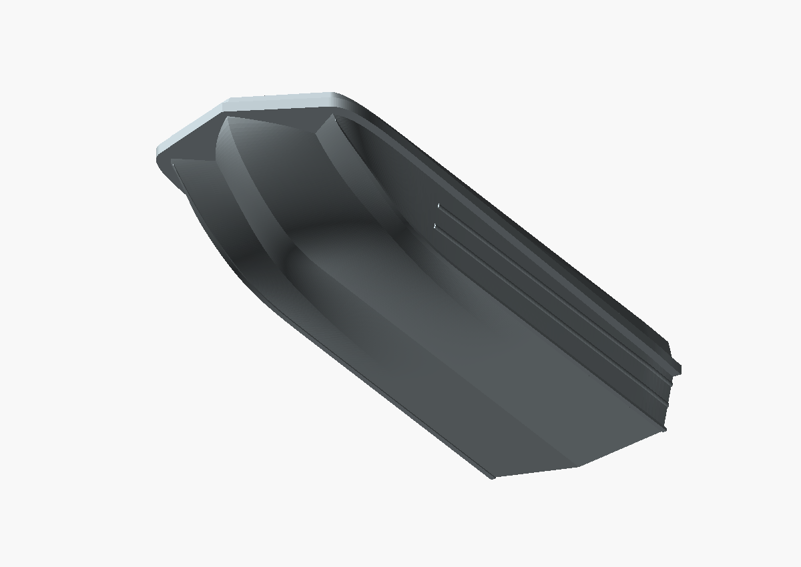

# Straight side ridges — 2026-10-23

The user supplied real-boat side photographs showing two horizontal
corrugations which stop before the upturned bow and extend to the transom.
The previous ridges incorrectly used a fixed fraction between chine and seam,
which curved their centrelines and carried them too far forward.

The corrected strips use fixed full-size Z=280 and 425 and X=1600..4600.
The front ends are flat and the aft ends terminate flush at the transom.
Only transverse position follows the side plating, so the ridges remain
attached while their side-elevation centrelines are strictly horizontal.
Their elliptical cross sections retain the previous print allowances.
The front station and heights are photographic estimates, not factory dimensions.

The separate chine spray flanges and upper protective rim retain their shapes.
Dimensions, bow guides, deck, framing and transom retain the previous milestone.
See [remaining reconstruction limits](../../PENDING_CORRECTIONS.md).

## Files and checks

- [80 mm STL](2026-10-23_sarepta_hull_80mm_straight_ridges.stl), imported by `view.scad`.
- [170 mm STL](2026-10-23_sarepta_hull_170mm_straight_ridges.stl), imported by `view-170mm.scad`.
- `source.scad`, `source-80mm.scad` and `verify_bow.scad` preserve this revision.

Both actual binary STLs pass edge pairing, vertex links, nonzero faces, positive
volume and single-component checks, with Euler characteristic 2. See JSON reports.
Curve/rim/datum checks and new horizontal-ridge placement checks pass.
No physical print or minimum-wall/self-intersection certification.

