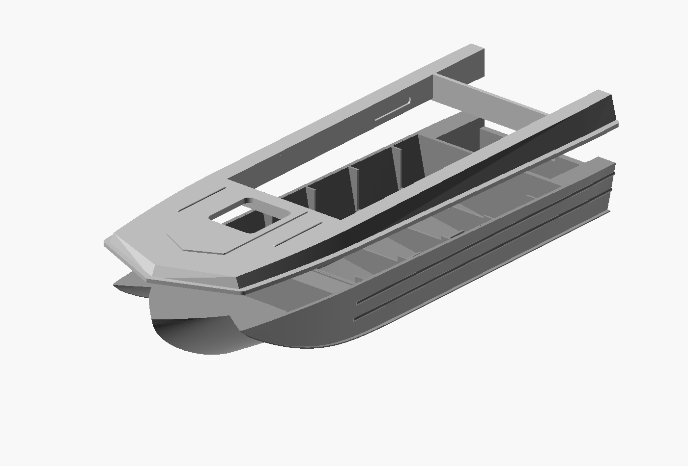
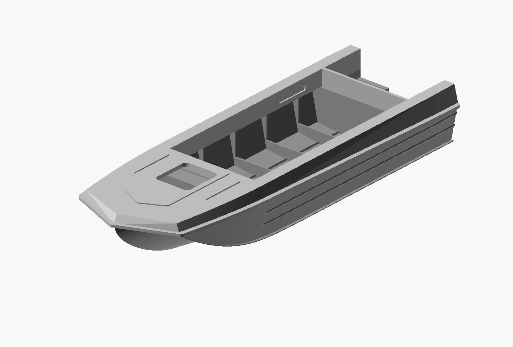

# Separate upper assembly — 2026-10-24

The accepted 170 mm bow-proportions STL is partitioned into a lower hull and
an upper deck/belt assembly for separate printing and adhesive assembly.
The original STL remains unchanged; no exterior surfaces are redesigned.

## Part ownership and mating surface

The split follows the inclined side seam beneath the protective rim, rather
than an arbitrary level waterline. With X measured aft from the bow in model
millimetres, the principal plane is:

`Z = 23.4808695652 - (120 / 4600) * X`

This is 0.08 mm below the nominal underside of the 1.2 mm rim sheet. The small
offset avoids coincident imported mesh faces and keeps the complete rim on the
upper assembly. Both halves share the same interface: no glue gap, added lip,
pins, sockets or exterior clearance has been introduced.

The two boxed inner returns beneath the cabin landing strips stay whole with
the upper part. Otherwise a planar cut would produce two loose triangular
strips below the seam. Their ownership masks extend 0.002 mm beyond their
nominal source bounds to cover binary-STL coordinate rounding. The cut thus
has small internal steps at these returns while the visible side seam remains
planar. Lower frames, bottom stiffeners and the motor-well floor remain below.

## Files and use

- `2026-10-24_sarepta_170mm_lower.stl`: lower hull, original assembly coordinates.
- `2026-10-24_sarepta_170mm_upper.stl`: deck, upper belt and protective rim,
  original assembly coordinates.
- `view.scad`: assembled exact STL pair in neutral grey.
- `exploded.scad`: upper half lifted 12 mm for inspection.
- `source.scad`: reproducible partition of the immutable accepted parent mesh.
- `mesh-report-lower.json`, `mesh-report-upper.json`, `partition-check.json`:
  exported mesh and partition checks.

Keep both parts at 100% scale. The assembled length is 170 mm; the lower hull
is shorter because the projecting deck tip belongs to the upper assembly.
Dry-fit and lightly finish the mating surfaces before gluing. Printing
orientation and supports must be prepared for each part separately; the
boxed returns extend below the main upper mating plane. The old one-piece
Bambu project must not be reused as a two-part print project.

Physical printing, adhesive selection and watertightness are untested.
Prototype dimensional and reconstruction limits from the parent release apply.

