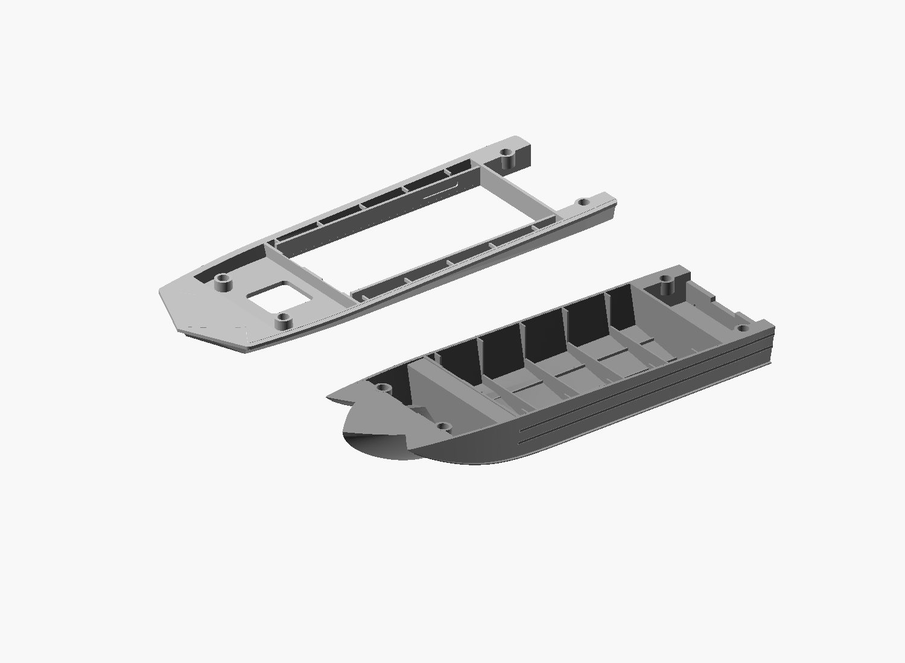

# Four locating pins — 2026-10-25

Four pairs of blind sockets locate the accepted 170 mm split hull for gluing.
The user's screenshot marked two bow and two aft positions. The forward pair
is moved aft to X=33 mm because a 4 mm deep bore near the thin tip would break
through the lower exterior. This is an assembly feature, not a prototype detail.

## Dimensions in model millimetres

- Pins: diameter 4.00, total length 8.00, including 0.35 insertion chamfers.
- Sockets: diameter 4.25, depth 4.20 in each part; 0.125 radial clearance.
- A centred pin enters each half by 4.00, leaving 0.20 at each blind end.
- Internal cylindrical pads: diameter 6.40, depth 5.00 into each part.
- Nominal pad end wall: 0.80; radial wall: 1.075.
- Socket centres in original assembly XY coordinates: (33, ±17), (160, ±22).
- All socket and pin axes follow the seam normal, tilted about 1.494 degrees
  from vertical. Holes on both parts are coaxial.

The principal interface remains `Z = 23.4808695652 - (120/4600)*X`.
The exterior and overall assembled length are retained. Pads fill internal
space locally and intentionally protrude slightly into the cockpit/well.
The original split inner returns remain whole with the upper assembly.

## Files and assembly

`2026-10-25_sarepta_170mm_lower_locating.stl` and
`2026-10-25_sarepta_170mm_upper_locating.stl` share their assembly coordinates.
`2026-10-25_sarepta_locating_pin_4x8.stl` is one pin; print four copies if needed.
`view.scad` shows both exported parts 90 mm apart, with the upper part turned
underside-up to expose its sockets; `assembled.scad` shows the
assembled pair. The views use actual archived STLs in grey.

Dry-fit the four pins before gluing. Printed hole fit depends on material,
orientation and printer calibration; the chosen clearance is untested.
Do not rescale the parts to adjust hole fit. These features are for the
170 mm version, rather than a globally scalable 80 mm trial.

## Verification and limits

Mesh reports inspect the exact exported files. The saved material probes test
all eight bores, their blind caps and radial walls. These are sampled checks,
not a complete minimum-wall or physical-fit certification. Prototype accuracy
limits remain those of the accepted parent model. No Bambu project is added.

Placement reference: `placement-reference.png` was supplied by the user in
this conversation; purple marks indicate approximate intended locations.
The front pair was deliberately moved aft to preserve blind-hole depth.

Repeat checks with `tools/verify_material_samples.py <STL> material-checks-<part>.json`
from the Sarepta project directory, and the bundled mesh inspector.
