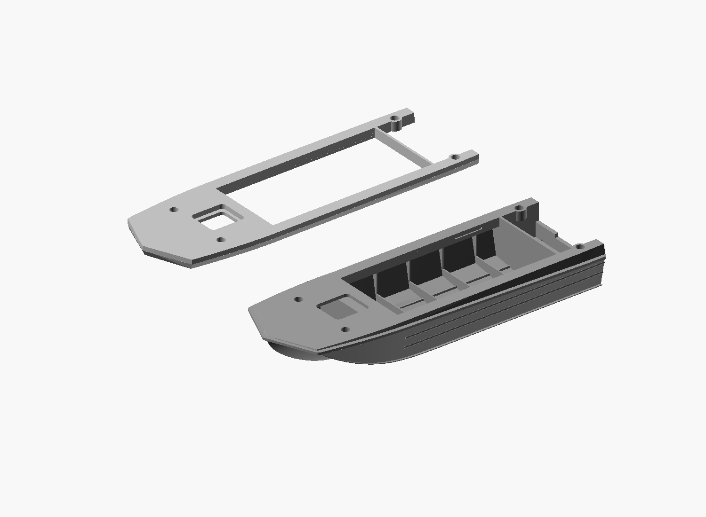
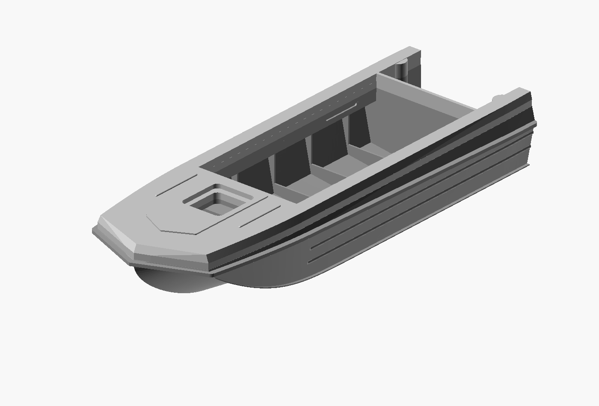

# Horizontal glue interface and reinforced bow — 2026-10-27

The user reported a deformed thin bow after printing the previous lower part
and poor mating of the inclined/stepped split. Heat was suspected by the user;
no failed-part photograph, temperature log or physical measurement was supplied.
The cause is not diagnosed. This revision addresses the vulnerable geometry.

## Changes in model millimetres

- A single horizontal interface at Z=25.00 replaces the inclined seam and
  internal return-ownership steps. Neither half extends through this plane.
- The original protective rim and the lower portion of the upper belt stay
  with the lower hull. A continuous nose/side landing, nominally 1.60 thick,
  reinforces the front cap and joins the boxed inner returns to the lower hull.
- The hatch, cockpit and motor-well openings remain open. The landing follows a section of the accepted upper envelope with a
  0.04 mm inward manufacturing offset; the three lower bow guides
  and underwater hull shape are retained.
- Geometry above the interface is raised 2.40. A matching solid landing band
  bridges the added height. Overall assembled height grows by 2.40, below the
  user's allowed 4 mm increase; length stays 170 and beam is unchanged.
- Four paired sockets retain XY (33, ±17), (160, ±22), but their axes are now
  vertical, with centres on Z=25.00. Bore diameter 4.25 and depth 4.20 per part
  accept the unchanged 4 x 8 pins. End-wall allowance is 0.80 in 6.40 diameter
  pads. Earlier parts with inclined sockets are not compatible with this set.

These are print/assembly allowances, not recovered prototype dimensions. The
upper belt shape acquires a short vertical band; the old visible inclined
protective rim is retained below the new functional glue plane.

## Files and assembly

The two STL files share assembly coordinates and must remain at 100% scale.
Their individual bounding lengths differ because the complete bow rim now
belongs to the lower half; do not rescale each piece to 170 mm separately.
`view.scad` shows both mating faces beside one another, with the upper turned
over for inspection. `assembled.scad` and `exploded.scad` show actual exported
STLs. `source.scad` preserves the native reconstruction dependency and partition.

The upper part can be translated down 25 mm so its entire mating face rests
on the print bed, with its detailed deck facing upward. This removes the old
hanging returns from the upper print. Slicer settings must be prepared anew;
the previous inclined-part Bambu project is obsolete for this revision.
Dry-fit the unchanged pins before gluing. Adhesive fit and watertightness of
the new revision are physically untested. Thickness changes do not prove the
reported print deformation will not recur.

Mesh reports and a horizontal-interface check inspect the exact exported
parts. Saved material probes check socket axes, caps and retained openings.
These checks do not certify a global minimum wall or physical print outcome.

## Verified export results

Lower bounds: 170 x 59.130436 x 25.000000 mm. Upper bounds:
167.655923 x 54.054287 x 5.579348 mm, at assembly Z=25..30.579348.
Both are single connected, paired-edge/vertex-link-valid closed meshes.
All 36 material probes passed, covering eight blind bores/caps/walls and
retained openings/landings. All 4963 sampled points on the upper mating face
are supported by the lower horizontal face; the lower face has a narrow
exposed ledge from the nominal 0.04 mm manufacturing inset (maximum sampled
boundary difference 0.055585 mm). The planes are identical, not tilted.

The unchanged pin is [the earlier 4 x 8 mm STL](../2026-10-25_locating-pins/2026-10-25_sarepta_locating_pin_4x8.stl).
Print four copies if needed. The new vertical sockets require both new hull
halves as a set.
