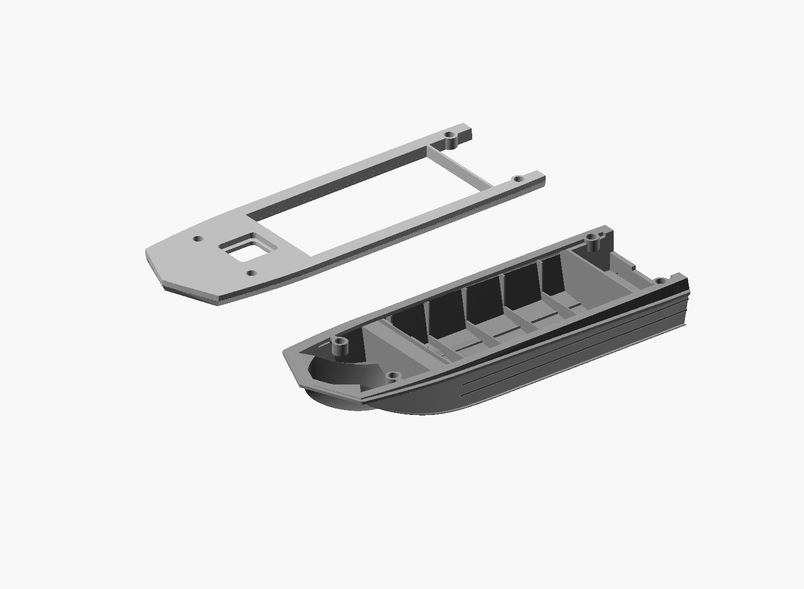

# Open lower hull with a 4 mm glue rim — 2026-10-27

This corrects the preceding horizontal revision: its full forward landing
blocked access to the bow compartment. The user requires open access before
installing the removable upper cover, while retaining a reinforced nose edge.

## Geometry and part compatibility

The lower part retains a nominal 4 mm inward-offset perimeter land at Z=25 mm.
The raised front edge and low upper-belt material remain with the lower hull,
but the central forward sheet is removed. Two narrow 2.4 mm webs retain the
original forward pin seats; local socket lugs extend inward beyond the nominal
rim. Rear seats already overlap the rim. These local features are not a full
nose cover. The side sheet is trimmed back and its obsolete suspended inner
returns are removed without altering the aft transverse frames.

The forward cavity is cleared by an upward-only sweep of the accepted lower
solid, starting 1.6 mm above its old lowest surface at each XY. A cached
32-position sweep (0.8 mm steps) removes legacy interior infill and disconnected
false-floor remnants without reaching the first 1.6 mm above the original
exterior. Existing thinner hollow bottom skin is left intact. This cutter is
clipped inside the rim and stopped ahead of the sealed lower locker wall.
The forward bulkhead and leg-space shelf are retained. This internal
accommodation is a print design, not a measured factory shell.

The accepted non-pocketed upper STL is reused byte-for-byte. It remains a
removable full cover, with its horizontal mating face at Z=25 and original
four blind sockets. The 4 x 8 pins and all socket centres are unchanged.
Overall length remains 170 mm; no further height increase is introduced.
Do not mix this set with the older inclined-interface parts.

The broad underside of the upper spans open interior space by design; only
the rim and local seats are glue contacts. It is not necessary or desirable
for the entire nose area to be backed by a lower sheet. The contact check
therefore tests the lower glue lands against the upper, not the reverse.

## Files and verification

`view.scad` shows both actual STLs beside one another; the upper is inverted
for viewing. `assembled.scad` shows the assembled geometry. The archived
source retains its immutable native-guide and horizontal-revision dependencies.
Mesh, material, sampled floor-preservation and joint-contact checks accompany
the exports. Those do not certify a global minimum wall, strength or physical
fit. The new revision is not yet physically printed.

## Verified export and reproduction

The final lower mesh is one connected closed boundary with zero paired-edge,
vertex-link or zero-area errors. All 25 material probes pass. All 5032 sampled
lower glue-land points are covered by the upper (0.06 mm boundary tolerance
accounts for the inherited 0.04 mm inset). All 642 sampled lowest exterior
surfaces are unchanged; sampled original skin points are retained.
The upper hash is identical to the accepted horizontal non-pocketed cover.

Use `tools/export_open_rim.sh <authorized-dated-output-directory>` from this
project to reproduce the lower STL. It calls the repository exporter, then
removes only exactly zero-area facets collapsed by float32 export and uses
the exporter again to publish the checked mesh. The archived result removed
60 such facets: no vertices moved, no nonzero facets/components removed and
no holes patched. The script refuses to publish a result failing mesh checks.
The intermediate `_construction.stl` file is not a print artifact.

Archive checksum registers exclude mutable macOS Finder metadata (`.DS_Store`).
