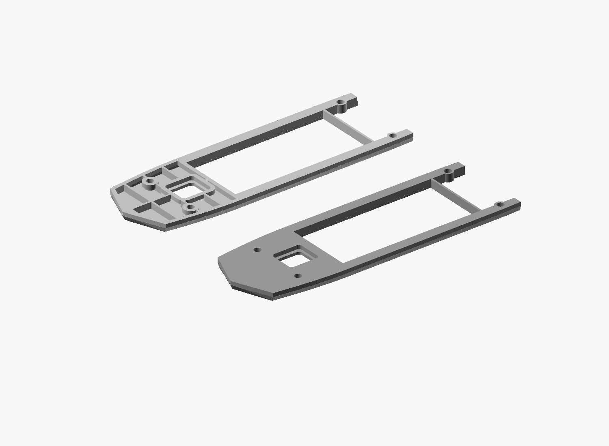

# Upper-deck pocket comparison — 2026-10-27

Comparison only: the accepted horizontal reinforced assembly remains current.
The lower hull is unchanged. The user asked to measure the material/time effect
of internal pockets before deciding whether to adopt them.

## Geometry

The candidate cuts rounded underside pockets in the forward solid band,
leaving a 2.4 mm perimeter/hatch landing, 1.2 mm webs and protected pin regions
of radius 4.4 mm. Pockets stop at Z=28.9, retaining about 1.217 mm of the
original roof skin. Added web extensions connect the retained webs to that
roof across the earlier shallow internal gap. All four sockets and their
blind caps remain unchanged. The glue strips remain horizontal at Z=25.
No strength equivalence is claimed; the candidate has not been printed.

## Actual Bambu Studio comparison

One upper part only, on A1 mini with a 0.4 mm nozzle and Generic PLA.
Both full project configurations were checked equal: 0.2 mm layers, two walls,
15% Grid, automatic tree supports, the same 45-degree plate rotation and
mating-face-down placement. Times include printer preparation.

| Upper variant | Total filament, including supports/brim | Estimated total time |
| --- | ---: | ---: |
| Accepted horizontal upper | 16.44 g | 47 min 00 s |
| Pocket candidate | 15.96 g | 49 min 39 s |

Saving: **0.48 g (2.92%)**, with **159 seconds longer** printing. Geometric
solid volume decreases 26.65%, from 16186.118 to 11873.281 cubic mm. That is
not the printed material reduction: the accepted shape already prints with
sparse infill, and the pockets create additional perimeters and supports.
An approximate G-code feature breakdown estimates support/interface material
rising from about 0.96 to 2.38 g. This breakdown is approximate; the table
uses the slicer's own totals.

Recommendation: retain the accepted unpocketed upper. The small saving does
not justify the extra time and untested strength change. Redesigning for
support-free printing is a different, untested comparison.

## Files and verification

The candidate STL, topology report, immutable-parent source and a grey actual
STL comparison view are preserved here. The source depends on the unchanged
parent release. All 26 material probes pass, including all upper socket bore/cap/wall
checks, open pockets, retained ribs, skin and mating strips. The candidate
is one connected closed manifold with no degenerate triangles. No global
minimum-wall, strength or physical-print certification is implied.

`comparison.json` records both print estimates, mesh/project hashes and the
Bambu version. Full machine/process/filament profile snapshots are included.
The corresponding sliced projects are under the authorized export directory:

- `stl_exports/2026/2026.10/2026.10.27/2026-10-27_sarepta_upper_comparison_baseline.3mf`
- `stl_exports/2026/2026.10/2026.10.27/2026-10-27_sarepta_upper_comparison_pockets.3mf`

