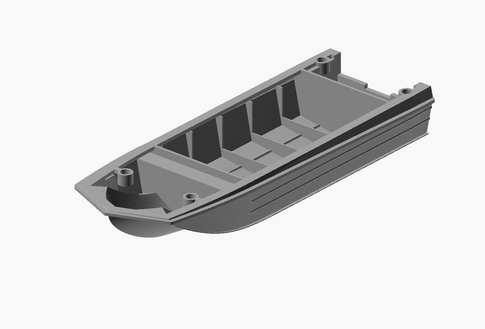

# Compartment partitions meet the horizontal cover — 2026-10-28

The previous open-rim revision cut the dashboard and motor-well partition tops
at Z=23.35 mm, while the cover underside and perimeter land are at Z=25 mm.
The cover rests on the rim; it cannot sink into the hull to close this 1.65 mm
slit. Earlier rim-only contact checks did not detect the partition gap.

The access cutter now protects the narrow existing compartment walls up to
Z=25. This restores continuous contact with the unchanged non-pocketed cover.
Both bow and cockpit remain accessible before fitting the cover; the 4 mm rim,
sockets, floor frames and exterior envelope are retained. The pre-existing
backed dashboard recesses are preserved. Wall-strip protection extends only
0.01 mm beyond each original panel face to avoid boundary ambiguity.

## Files and validation

- `2026-10-28_sarepta_170mm_partition_joint_lower.stl`: revised lower hull.
- `2026-10-27_sarepta_170mm_horizontal_upper.stl`: unchanged accepted upper.
- `view.scad`: both actual exported meshes, upper inverted and offset for viewing.
- `assembled.scad`: the same meshes at their assembly coordinates.
- `source.scad`: reproducible construction with immutable earlier dependencies.
- `partition-contact-check.json`: 164 cross-panel samples meet at Z=25, zero gap.
- `open-rim-check.json`: all 5128 sampled lower contacts supported by the cover;
  all 642 sampled lowest exterior surfaces unchanged.
- All 25 saved material probes pass; lower is one closed mesh with zero edge,
  vertex-link and zero-area errors. Bounds remain 170 x 59.1304 x 25 mm.

Reproduce with `tools/export_partition_joint.sh` and the authorized dated export
directory. The Manifold float32 construction export needs the same strictly
limited cleanup as its parent: remove 60 exactly zero-area facets, move no
vertices and remove no nonzero facets or components, then republish through
`export_stl`. The script refuses an invalid result. Intermediate construction
exports are not print artifacts.

This is a digital contact check, not a physical print-fit test. Prototype
reconstruction uncertainties and the previous +2.4 mm print allowance remain.
The previous upper and 4 x 8 mm locating pins can be reused.

