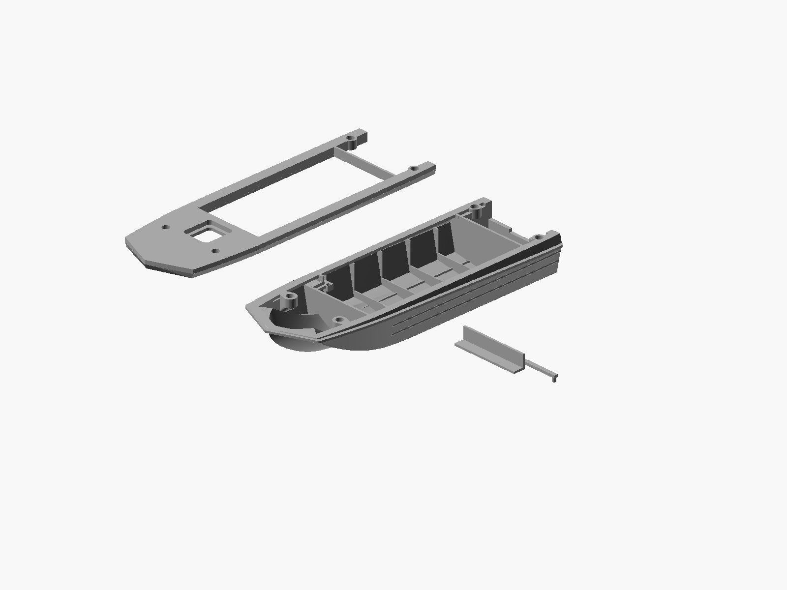
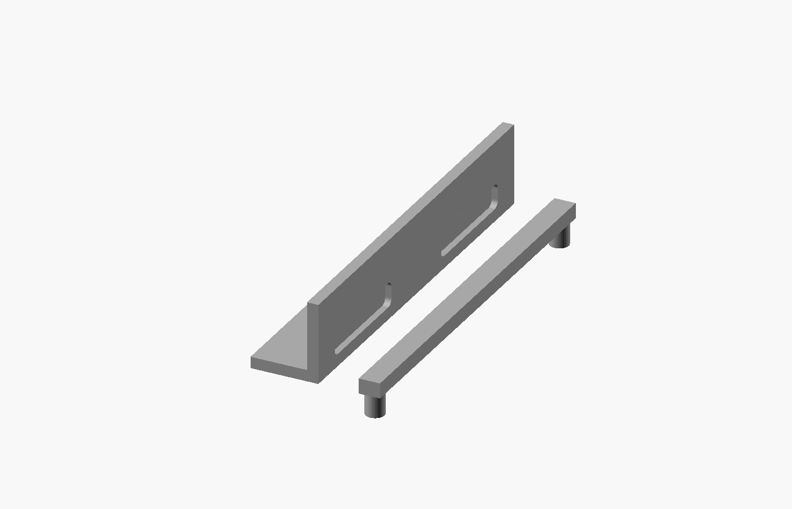

# Serviceable dashboard and printable chine — 2026-10-28

Four STL parts replace the previous two-part set at the same 170 mm length.
This revision is a printable reconstruction; clearances and reinforcements are
modelling allowances rather than factory measurements. Previous releases remain
immutable.

## Changes

- Front locating sockets: 7.2 mm nominal reinforcement diameter, full-height
  lateral webs and sloped roots extending down toward Z=12. Original four
  locating axes, 4.25 mm bores and 0.8 mm blind bottoms retained.
- Dashboard plus footwell ceiling: one removable L-shaped piece, 40.8 mm wide,
  7.141 mm long and 8.391 mm tall. The fixed nose-compartment wall stays in the
  hull. Open-ended side seats support the shelf; clearance is 0.25 mm per side,
  0.25 mm at the forward wall and 0.2 mm above the instrument face.
- Stop bar: removable from above, with two 2 mm pegs in 2.3 mm blind sockets.
  Its 40.8 mm width fits the cockpit opening after the cover is glued. Lift
  the bar clear, slide the dashboard 10 mm aft, then lift out the dashboard.
  Do not glue the dashboard, guides or stop bar.
- Upper cover **changed internally**: clearance removes the fixed dashboard
  continuation below the foredeck, leaving 1.2 mm of deck skin. Exterior roof,
  hatch/relief, cabin landings and locating axes retained. Use the new upper
  with this dashboard; the old cover obstructs its full-height installation.
- The roughly 1.1 mm outward chine strip is removed along both sides. A 0.015 mm
  guide allowance protects the original skin; this is below the FDM line width.
  The upper protective rim and horizontal side corrugations remain.

## Files and viewing

- `2026-10-28_sarepta_170mm_service_lower.stl`: reinforced lower hull and guides.
- `2026-10-28_sarepta_170mm_service_upper.stl`: cover with underside clearance.
- `2026-10-28_sarepta_170mm_service_dashboard.stl`: removable panel and shelf.
- `2026-10-28_sarepta_170mm_service_retainer.stl`: locking bar with two pegs.
- `view.scad`: actual exported STL parts separated for inspection.
- `assembled.scad`: actual STL parts at assembly coordinates.
- `dashboard-view.scad`: close view of the removable parts.
- `source.scad`: construction snapshot with immutable source dependencies.

The four original 4 x 8 mm hull/cover locating pins remain usable. The smaller
retainer pegs are integral to the stop bar. Print parts separately: do not slice
`assembled.scad` as one joined model. Orient the dashboard on its flat shelf,
and invert the retainer with pegs pointing upward. No Bambu project prepared.

## Verification and limits

All four exact STL files pass closed-edge, vertex-link, nondegenerate-triangle,
positive-volume and single-component checks. Lower/upper bounds respect the
horizontal Z=25 split. Lower export cleanup removes only 168 exactly zero-area
float32 facets, with no vertices moved, holes patched or components removed.
Upper, dashboard and retainer are direct CGAL exports.

All 33 material probes pass, including blind sockets, full-height socket webs,
web roots, retainer sockets and the removed central shelf. The movement check
passes 7947 dashboard samples over nine aft translations up to 10 mm and 592
retainer samples over eight upward translations up to 12 mm. This is sampled
collision testing, not a continuous kinematic proof.

All 5196 sampled lower mating-face points are covered by the upper within the
inherited 0.06 mm boundary tolerance. Contact analysis excludes one negative
float32 coplanar sliver of area 1.304e-8 mm2; this does not alter the exported
mesh. The 594 original exterior samples inside Y=+/-22 mm are unchanged; the
outboard chine strip is deliberately different. No global minimum-wall or
physical-print fit certification is claimed. Perform a dry fit before gluing.

Reproduce with `tools/export_serviceable.sh <authorized-dated-output-directory>`.
The motion test is `tools/verify_service_motion.py <this-release-directory>`
using a Python installation with NumPy. Material and mesh checks use the saved
JSON probes and existing project tools. No physical print has been verified.

