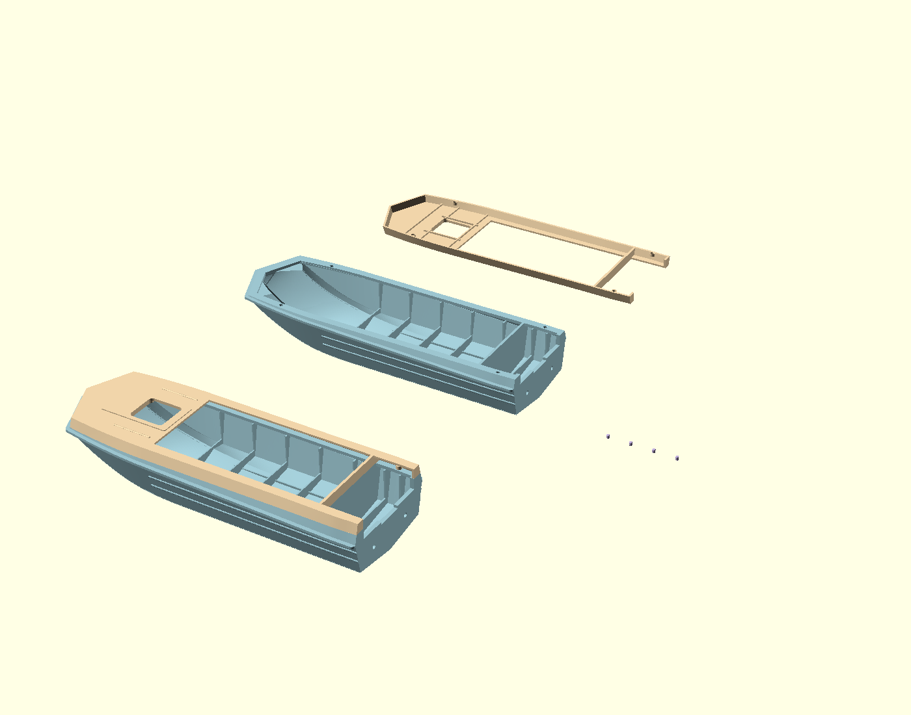
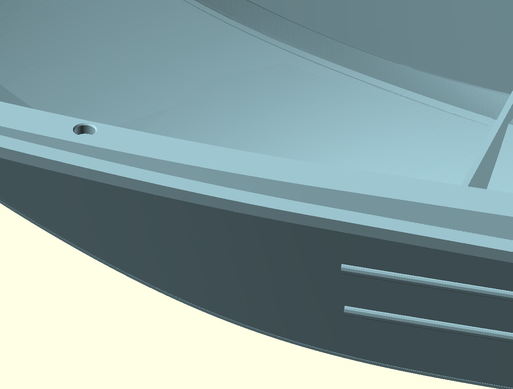
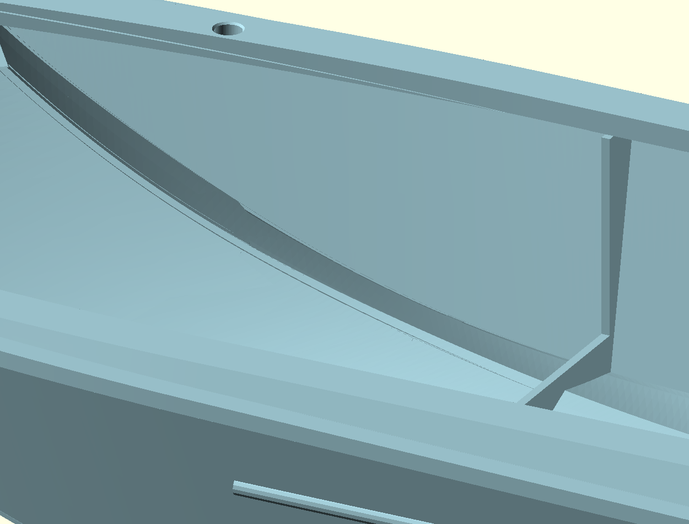
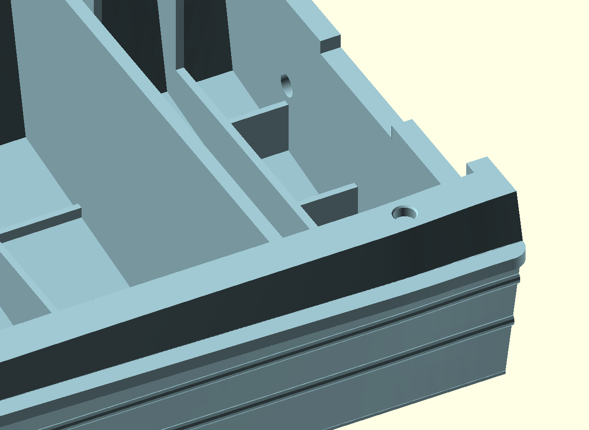

# Level stern ribs and clear bow floor — 2026-10-31

Default deliverable: `inspection-view.scad`, with detached hull, inverted cover,
four pins and the assembled model in pastel colours. The reference dashboard
remains hidden. This is an unprinted digital revision.

## Stern ribs and outlets

The preserved level-stern parent replaces the sloping transom knees with three
0.65 mm horizontal ribs at Z=8.130435 mm, matching the transverse floor tops.
Their visible ends stop at the aft face of the last transverse floor, X=162.4 mm.
A 0.1 mm internal overlap starts at X=162.3; no rib projects into the bay forward
of that floor. They join the nominal X=168 mm inner transom face.

The two unchanged 2.217391 mm diameter drains align with the outer rib axes,
Y=+/-12.934783 mm. Their centres are Z=10.039130 mm and their lower edges are
Z=8.930435 mm: exactly 0.8 mm above the rib-top plane, within STL float precision.
Earlier holes are filled. The transom height, cover contact and side corners
are retained.

## Remaining bow-floor remnants

The additional owner screenshots showed small remnants at the floor/side
transitions missed by the prior side-only cuts. The new subtraction covers the
full inner bow ahead of X=61.5 mm, using a 26-direction 1.2 mm shell envelope of
the original filled outer hull. The upper belt envelope has an additional 0.05 mm
inward margin, and the subtraction stops at Z=23.30 mm, below the mating land and
blind guide ends. These margins avoid re-cutting coincident old mating surfaces.

Protection masks retain the existing longitudinal bottom stringers. They preserve
old material only; they do not add new blocks or reinforce the floor. Exposed rib
heights are compared with the preceding parent. Where an original stringer is
buried below the sloping bow floor it has no exposed top to compare; those floor
surfaces are intentionally cleaned. The ordinary transverse frames are outside
the bow-cleanup region and remain unchanged.

The lower is constructed by subtracting the cleanup from the exact verified
level-stern mesh. Its parent source and all dependencies remain available.
The upper, pin and hidden reference dashboard meshes are unchanged copies of
that parent. No part is repositioned in its assembly coordinates.

## Verification and reproduction

`verification.json` records material-clearance samples at the former remnants,
retained stringers and pin seats, mesh-derived equal stern-rib tops, the 0.8 mm
outlet gap, no forward rib overhang, exterior/bottom comparisons and topology.
All pictures use the final archived meshes. These finite digital checks are not
a global normal-thickness proof or a physical print/fit certification.

`raw/` contains the unchanged repository-tool export. Final mesh refinement only
removes zero-area float facets and splits exact collinear T junctions; it moves
no vertices and fills no holes. `export.sh <authorized-absolute-dated-directory>`
reproduces the changed lower, keeping historical files intact. `verify.py` checks
the archived matched components. `source.scad` is editable construction based on
preserved source and mesh inputs.

