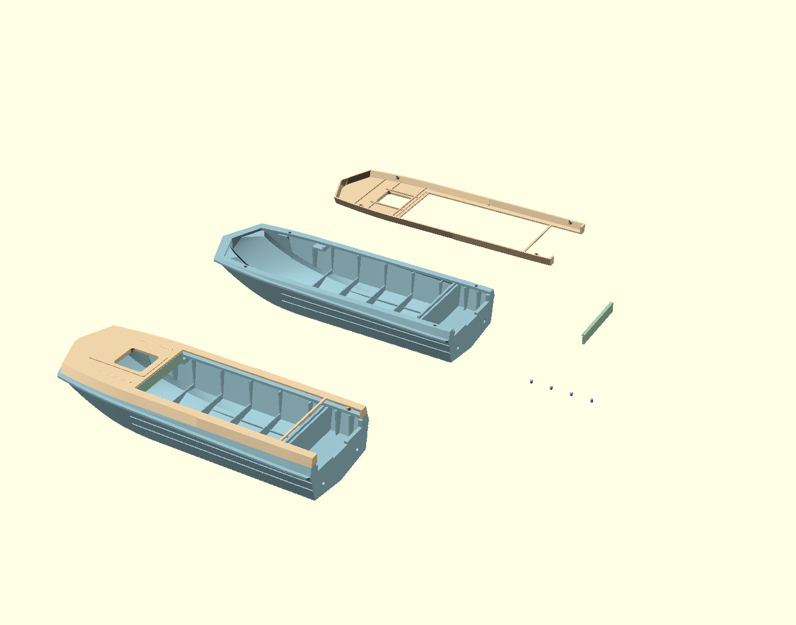
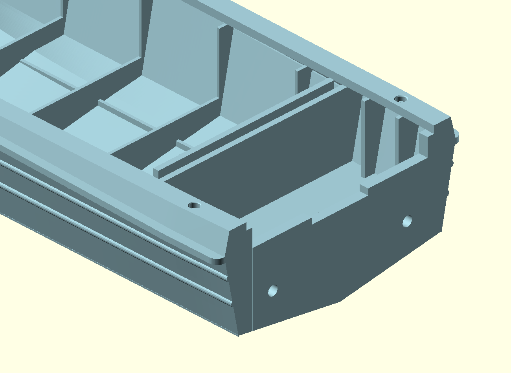

# Clean stern and continuous rim — 2026-10-31

Owner-directed revision of the fair-cover model. Previous releases are preserved.
The default deliverable is `inspection-view.scad`: detached hull, inverted cover,
instrument panel, four glue pins and a complete assembly, all at the original
scale. Component colours are pastel blue, sand, sage and lavender respectively.

## Changes

- Replace the stepped/recessed upper mating edge with a continuous nominal 4 mm
  normal offset at Z=25 mm. Extend the inner offset beyond the stern so it cannot
  create an unwanted crossbar. Preserve the well-front partition.
- Open the stern bay to the existing outer side skin, removing the old continuous
  inner box walls. Add two discrete 0.8 mm side ribs per side, retaining the three
  floor/transom knees. Keep cuts inside the accepted lower cavity and the upper
  reverse-flared skin; do not cut the external protective rim.
- Keep 1.6 x 2 mm positioning pins on the shared axes (33,+/-23.6) and
  (160,+/-24.4). Enlarge both halves' blind bores to 2.0 mm diameter, with 1.1 mm
  depth and a 0.15 mm entrance taper to 2.3 mm. This provides 0.4 mm nominal
  diametral clearance; physical print fit still requires checking.
- Rebuild the motor transom as one full-depth plate with its rear face at X=170.
  There is no 0.02 mm recessed upper cap. Halve the previous added rise, giving
  Z=17.923370 mm at the central motor seat and Z=19.309239 mm at its shoulders.
- Double drain diameter from 1.108696 to 2.217391 mm. Retain lateral positions
  Y=+/-15.891304 mm. Raise the hole centres with their radius so the lower edge
  remains 0.15 mm below the estimated well-floor level rather than lowering the
  outlet unnecessarily into the solid floor.

The cover exterior, single 1 mm roof skin, open ribs, separate panel and lower
external side/bottom shapes are retained. Guide holes change in both upper and
lower: use the new matched pair. Dashboard and pin meshes are byte-identical
copies of the previous revision. Hatch lid, transverse splitting and separate
protective-rim parts remain pending.

## Verification

`verification.json` records 939 material/clearance probes, 119 join/tangent
samples and 1394 unchanged exterior-side comparisons. All passed. Both new
meshes are closed, single-component positive-volume solids without degenerate
faces, edge pairing errors or invalid vertex links. Maximum sampled glue-joint
position error is 0.000003 mm and angle error is 0.050 degrees. Sampled lower
exterior-side difference is below 0.000001 mm.

`raw/` preserves the exact binary exports from the repository `export_stl` tool.
`clean_export.py` removes float-collapsed zero-area triangles and splits exact
collinear T junctions without moving vertices, filling holes or changing surfaces.
The final archived STL files are the meshes used by all inspection views.

These digital checks do not certify physical print fit, strength, watertightness
or drainage performance. No new slicer project has been prepared.

## Reproduction

Run `export.sh <authorized-absolute-dated-output-directory>` with OpenSCAD on PATH.
On this Mac, the x86_64 architecture of the installed universal binary works.
`source.scad` is editable construction, `continuation.scad` is the unchanged
fair-cover continuation, and `verify.py` checks the final meshes. Dependency
paths are relative to the preserved release tree.

