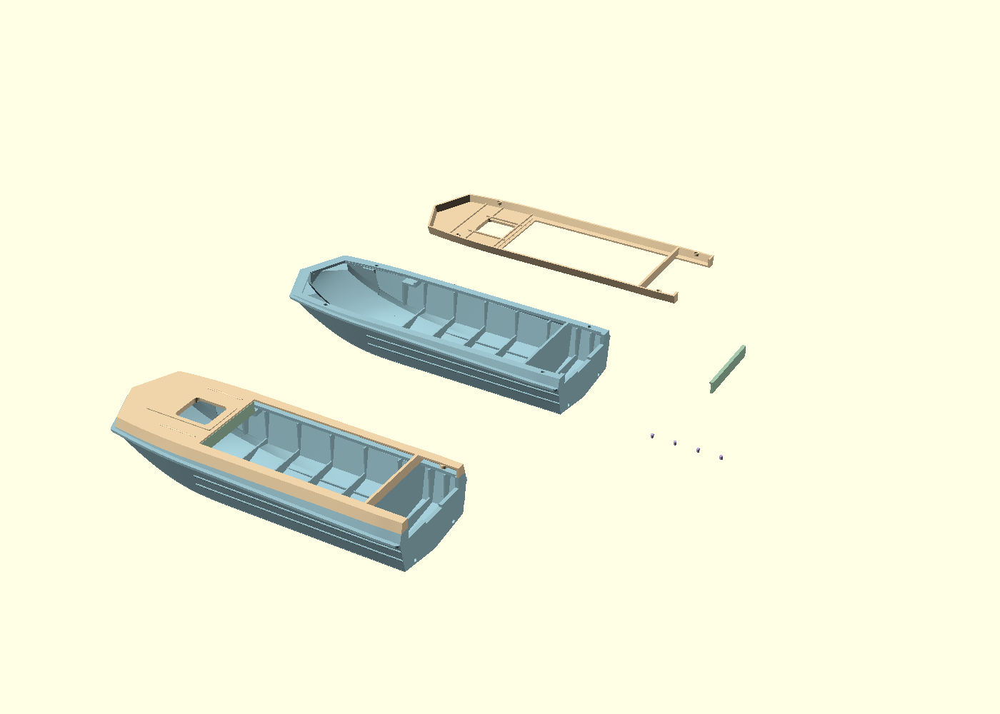
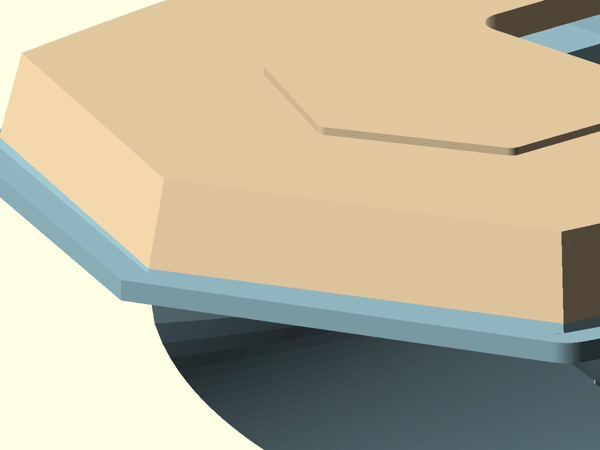
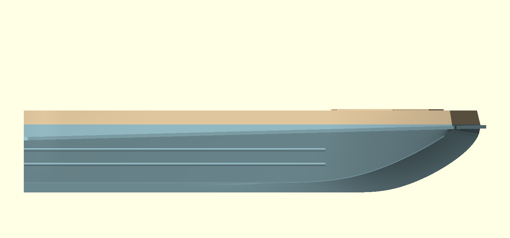
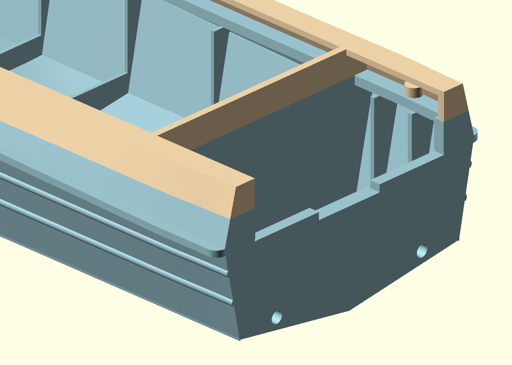

# Continuous master-plan belt and open stern — 2026-10-31

Owner-directed replacement of the faceted STL-normal continuation. Previous
milestones are preserved. The default deliverable is `inspection-view.scad`:
detached hull, inverted cover, dashboard, four positioning pins and a complete
assembly, all at original scale and in pastel blue, sand, sage and lavender.

## Rebuilt geometry

The exterior belt is one shared ruled solid generated from the accepted plan:
a straight V bow, a cubic shoulder, a straight main side and the existing smooth
stern taper. Its normal offset is trimmed to meet the straight V faces; no dense
miter corner is allowed to fold back across the shoulder. Two planar bow faces
meet at one explicit central vertex at every height. A continuous analytic slope
field replaces the previous independent triangle normals. Both parts are split
from this same solid at Z=25 mm, so no separate sideways adjustment is applied.

The lower exterior belt above the original protective rim is intentionally
rebuilt to agree with the cover. The original bottom, lower sides, exterior rim
and pressed grooves remain on the archived parent. The cover retains its 1 mm
roof, open underside, local ribs, hatch opening, pad and beads. Nominal glue-land
width is 4 mm. The paired 2 mm blind holes and their entrance tapers accept the
unchanged 1.6 x 2 mm guide pins with 0.4 mm nominal diametral clearance.

The raised stern-bay floor is removed down to the original bottom cavity.
Bottom stringers, transom knees and two transverse/side rib pairs remain.
Both rear side corners extend to the mating plane, eliminating the square gaps
under the cover. The lower divider is raised on its actual axis, centred at
X=4000*170/4600+0.6 mm. Its 1.3 mm thickness overlaps the previous 1.2 mm wall
by 0.05 mm on each side. The cover continuation uses exactly those same X faces
and extends fully down to Z=25, meeting the lower divider rather than hovering
above it. The displaced forward cap is removed.

The one-piece transom and halved added height from the preceding revision are
retained: centre Z=17.923370 mm, shoulders Z=19.309239 mm. The two 2.217391 mm
drains move down to Z=4.55 mm on Y=+/-15.891304 mm to follow the actual bottom.
The previous raised outlets are filled. Dashboard and pin meshes are unchanged.

## Digital checks

`verification.json` records 460 material/clearance probes, 476 side-wall probes,
119 joint/tangent samples and 318 unchanged bottom comparisons. All pass.
Minimum sampled horizontal side material is 1.047 mm, including guide regions.
Maximum sampled joint tangent difference is 0.082 degrees; the difference between
outer coordinates 0.002 mm apart in height at the joint is 0.00110 mm. The largest
sampled longitudinal second difference is 0.00067 mm over 0.25 mm intervals.
Bow-guide faces meet the planar V constraint within numerical precision, and
every generated half-outline is strictly monotone in X, ruling out the prior
offset fold. Sampled bottom differences are zero.

Both final meshes are closed, single-component, positive-volume solids with valid
edge pairing and vertex links. `raw/` preserves exact repository-tool exports.
`clean_export.py` only removes float-collapsed zero-area facets and splits exact
collinear T junctions; it moves no vertices and fills no holes. All pictures are
rendered from the final archived meshes. Owner screenshots are preserved under
`feedback/`. These finite checks and rendered views do not certify physical print
fit, minimum normal thickness everywhere, strength or drainage performance.

## Reproduction and inspection

`generate_belt.py` regenerates `belt.scad` and its guide record using the Python
standard library. `source.scad` is editable construction. `export.sh` reproduces
raw and refined STL files in an authorized dated output directory, without
rewriting historical meshes. `verify.py` checks the archived matched pair.
On this Mac, OpenSCAD runs using the x86_64 architecture of its universal binary.

