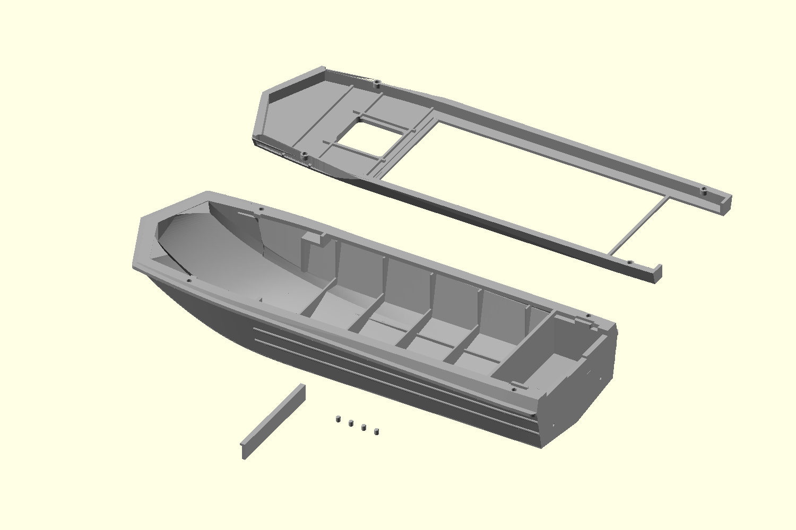
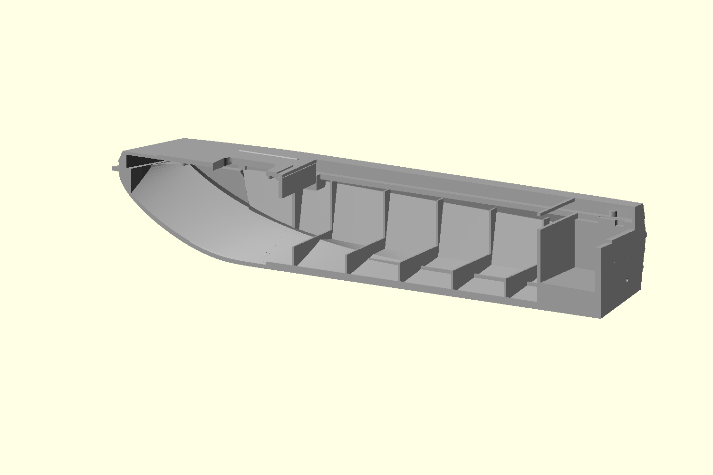

# Lightweight open deck — 2026-10-31

A new 170 mm design revision following the owner's assembled-print photographs
IMG_2596..2599. The previous 0.1 candidate and its binaries remain unchanged.
This is an unprinted model revision, not a factory drawing or a new release tag.

## Changes and assembly

- The upper has one 1.0 mm roof skin, open underneath, with 0.8 mm wide,
  1.0 mm deep local ribs. There is no second lower foredeck sheet or sealed
  lightweight cavity. The hatch surround and cockpit-front edge are continuous.
  The external raised pad, straight deck beads and accepted outline remain.
- The instrument panel is a single 1.2 mm face with a small integral upper lip.
  Its top is at Z=28.967 mm, with 0.2 mm assembly clearance beneath the local
  cover recess. A hidden integral lap ahead of the face overlaps this clearance
  vertically. No separate retaining bar, retaining pins, sockets or shelf.
  Glue the panel at its upper/side interfaces if needed; it is not mechanically
  locked. Insert and dry-fit it before gluing the upper cover.
- The sealed central forward partition and footwell shelf are opened. Small
  structural margins at the original side plating remain; the model no longer
  has a separately sealed bow locker. The aft motor-well partition is retained.
- Four small glue locators replace the 4 x 8 mm dowels and large socket bosses.
  Print **four copies** of the pin STL: diameter 1.6 mm, length 2.0 mm including
  lead-ins. Shared axes are (33,+/-24.4) and (160,+/-25.1) mm. Blind holes are
  1.85 mm diameter and 1.1 mm deep in each half. Their clearance is a print
  allowance, not a prototype measurement. Pins guide the glue-up, not carry load.
  Old dowels are incompatible. The bores and minimal upper seat material remain
  within the side glue strips, clear of the external hull and motor-well opening.
- The rear motor-transom top is raised halfway toward the existing gunwale:
  centre Z=13.859 -> 21.988 mm, shoulders Z=15.707 -> 22.912 mm. The central notch
  remains. The new rear-wall addition is inset 0.02 mm at its back face to avoid
  coincident export faces; existing lower rear plating is unchanged. The motor
  mounting height is deliberately a model modification and will require the
  future printed outboard to match. Original drain holes remain.
- The removed lower chine flange stays removed. The protective upper rim and
  horizontal side ridges remain on this revision; rim separation, transverse
  splitting and a working hatch hinge/lid remain pending subsequent work.

The horizontal body/cover join remains Z=25 mm. Use these parts as a matched set;
old cover, panel and 4 mm pins do not share the new joint geometry.

## Material comparison

Volumes below are from the exact closed STL solids, not slicer filament estimates.
They exclude support material and do not predict finished mass or flotation.

| Part | Previous service version, mm3 | New version, mm3 | Reduction |
| --- | ---: | ---: | ---: |
| Upper cover | 15966.986 | 6803.385 | 57.4% |
| Lower hull | 33274.772 | 31963.579 | 3.9% |
| Dashboard | 662.467 | 330.276 | 50.1% |
| Retainer | 161.217 | Removed | — |

Each new small pin occupies 3.842 mm3. At the saved PolyTerra density of
1.31 g/cm3, the upper's geometric material difference corresponds to approximately
12.0 g. This is a solid-material comparison, not a promise of slicer savings.
The useful change is concentrated high in the bow rather than just changing infill.

## Inspection and verification

Open `layout-view.scad` in OpenSCAD for the exported grey STL parts, including
an inverted cover and four locators. `section-view.scad` shows the assembled
centre section; `upper-view.scad` shows the inverted upper alone. Display
translations do not alter the assembly coordinates in the individual STL files.

`verification.json` records all four closed, single-component mesh checks,
554 material/clearance probes and 648 bottom comparisons with the old service
hull. All passed. The probes check blind guide ends, material around their bores,
continuous roof at the hatch/cockpit edge, an open roof underside, removal of the
central partition and retaining seats, panel non-intersection, and transom height.
The sampled original bottom coordinates are unchanged within 0.0001 mm.

The lower's float export is refined only by dropping zero-area facets and
splitting triangles at existing exactly collinear vertices. No vertices move,
no holes are filled, no components are discarded and the surface volume is
unchanged within 1e-7 mm3. See `clean_export.py` and `export-cleanup-lower.json`.

This does not certify minimum thickness everywhere, assembled sealing, print fit,
strength, flotation or resistance to water entering over the stern. A physical
dry-fit and water test are still required. The owner's successful straight-along-
the-bed placement remains the orientation baseline for a future Bambu project;
no Bambu project was prepared for this geometry.

Reproduce with `export.sh <authorized-absolute-dated-output-directory>`, which
uses the repository `export_stl` for all final files. Run `verify.py` with a
Python environment containing NumPy against the archived, date-prefixed files.

