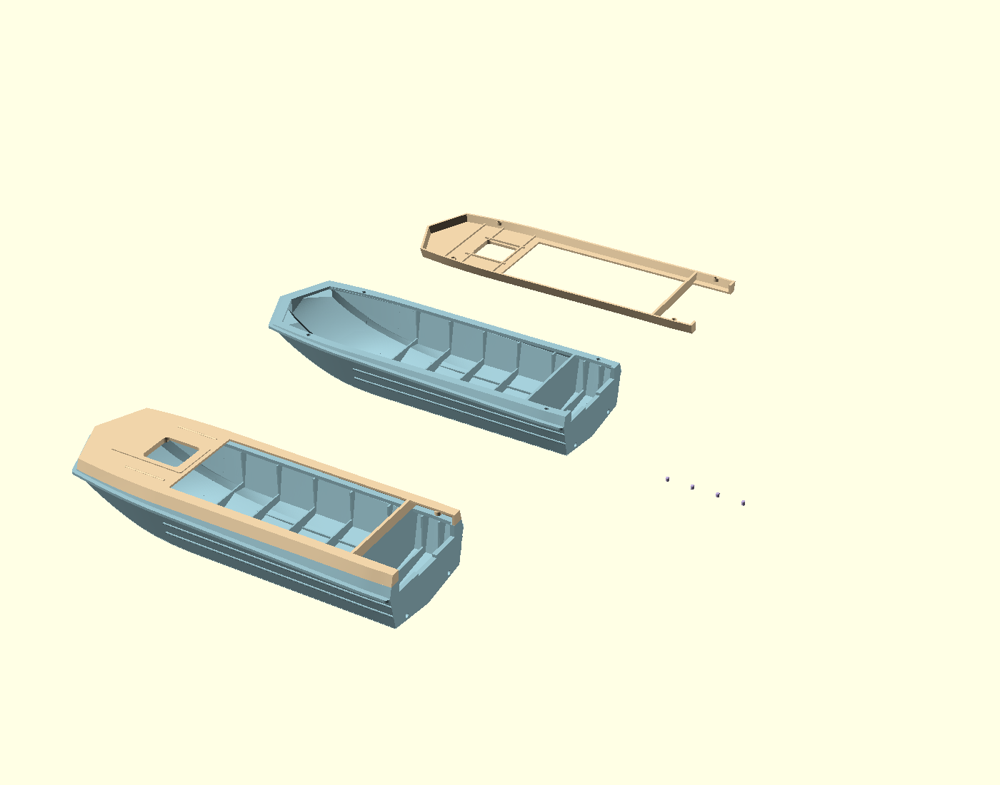
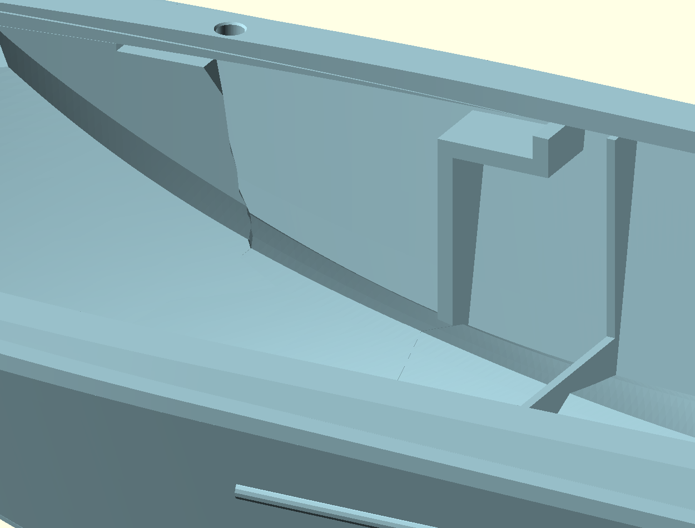
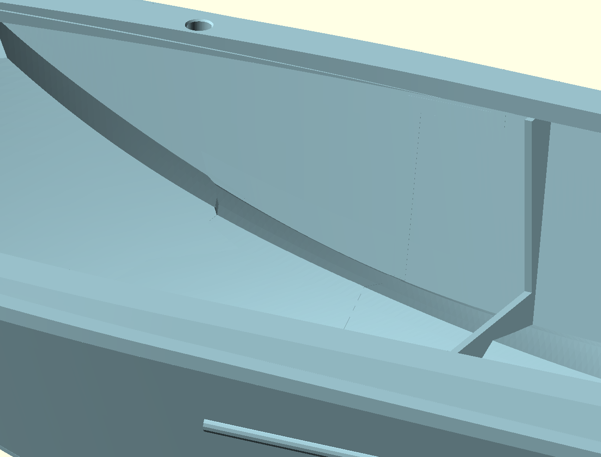

# Open bow, panel temporarily hidden — 2026-10-31

The owner asked to remove the green dashboard for now, remove the ineffective
side mounting growth, and identify the intrusive internal bow material.

## Changes

`show_dashboard=false` hides the dashboard in both the complete assembly and the
detached-parts view. The panel source and unchanged archived mesh remain available
as a reference. The upper cover no longer has the old integral panel lap or its
insertion recess. Re-enabling the reference panel is not a verified mounting plan.

The lower hull loses the side remnants of the previous shelf and forward
partition. Separate old internal webs near the former forward locating positions
are cleared as well. These were inherited volumes left by earlier cavity cutters,
not part of the accepted external hull shape. The legacy inner-cavity cut alone
does not reach those webs, so their removal is also bounded by a conservative
1.25 mm six-direction erosion of the original filled hull and by the new belt
inner envelope. The centre bow geometry is excluded from this supplementary cut.
This preserves the actual bottom and outer plating while clearing the two inner
sides ahead of the first ordinary frame at X=1700*170/4600 mm.

The current 4 mm mating rim, matched 2 mm guide holes, blind end walls, four
1.6 x 2 mm pins, coherent belt, planar V bow, aligned rear divider, open stern
bottom, ribs, transom and lowered drains remain in place. The supplementary cut
ends 0.02 mm above the old rim-underface plane to avoid coincident faces; there
is still 0.53 mm of material below the lower blind guide ends.

The default deliverable remains `inspection-view.scad`: detached hull, inverted
cover and four pins, plus the complete assembly. Pastel part colours are retained;
the green panel appears nowhere in the default scene.

## Validation and limits

`verify.py` checks the actual archived pair, including empty former mounting/web
locations, remaining side plating, guide clearances and end walls, rear contact,
unchanged bow exterior and bottom, and mesh topology. `verification.json` records
the measured results. Both meshes are closed positive-volume single-component
solids with valid vertex links and edge pairing after the existing exact
surface-preserving export refinement. No vertex movement or hole filling occurs.
Physical print fit and structural strength are untested.

`raw/` contains untouched repository-tool exports. `source.scad` is editable
construction. `export.sh` writes new raw and refined exports to an authorized
dated directory without overwriting historical files. The belt and pin meshes
are based on the preceding accepted digital revision. Owner screenshots and
same-camera before/after views are preserved for review.

