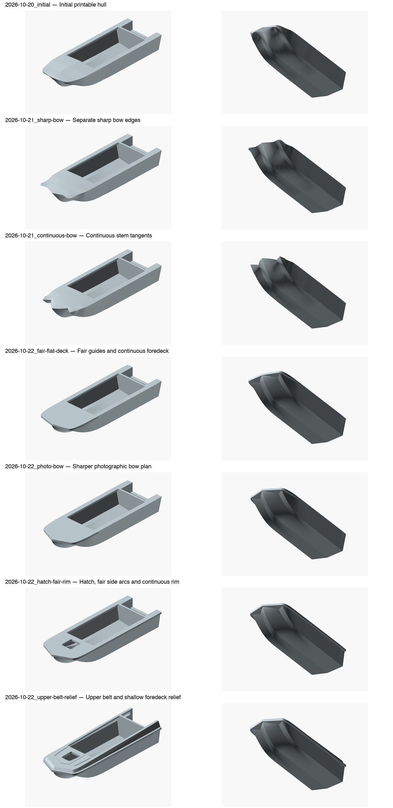

# Sarepta STL development history

Eleven 80 mm milestones and the latest 170 mm model are preserved byte-for-byte.
The first seven form the archive checkpoint pushed as `cc04d8c`; the eighth
applies the dimensional and framing revision; the ninth straightens the side
corrugations using the user photographs; the tenth refines leg space, landings
and interior details; the eleventh reviews bow/deck proportions and their
conflicting source evidence. Historical metadata describes
its capture checkpoint; `manifest.json` identifies the current stage.
Pictures import actual archived STL meshes. No milestone has a verified physical print.

| Stage | What changed | Mesh size, mm | Known limitation |
| --- | --- | --- | --- |
| [Initial printable hull](2026-10-20_initial/README.md) | Initial station-table reconstruction and 80 mm trial. | 80.000 x 27.826 x 13.948 | Bow contours collapsed near the deck; stem shape and longitudinal station positions were provisional. |
| [Separate sharp bow edges](2026-10-21_sharp-bow/README.md) | Preserved individual centre/side stem endpoints and paired bow tunnels. | 80.000 x 27.826 x 13.948 | Stem lines still kinked where endpoint offsets transitioned into the body. |
| [Continuous stem tangents](2026-10-21_continuous-bow/README.md) | Replaced short endpoint offsets with independent Hermite profiles and smoother joins. | 80.000 x 27.826 x 13.948 | Remaining curvature dents and scalloped foredeck perimeter; superseded. |
| [Fair guides and continuous foredeck](2026-10-22_fair-flat-deck/README.md) | Adopted three convex quintic Bezier guide profiles, smooth flat aft joins and a continuous foredeck. | 80.000 x 27.826 x 13.043 | Plan-view bow was too blunt, around 154 degrees; reconstruction remains approximate. |
| [Sharper photographic bow plan](2026-10-22_photo-bow/README.md) | Matched an apparent near-top photo angle of about 132 degrees; model angle 132.501 degrees. | 80.000 x 27.826 x 13.043 | Photographic angle is not a factory dimension; hatch, side-curve and rim work followed. |
| [Hatch, fair side arcs and continuous rim](2026-10-22_hatch-fair-rim/README.md) | Added the hatch opening, removed the S-shaped shoulder and continued the protective rim around the bow and sides. | 80.000 x 27.826 x 13.043 | Flat upper deck omitted the reverse-flared upper belt; 50 mm prototype rim and hatch sizes were estimates. |
| [Upper belt and shallow foredeck relief](2026-10-22_upper-belt-relief/README.md) | Added inward-sloping upper sides, a pointed raised pad around the hatch and two shallow rounded ribs. | 80.000 x 27.826 x 16.522 | Historical pre-correction geometry: seam was incorrectly placed at 750 mm before adding the upper belt, giving up to 950 mm prototype height. Transom remains 400 rather than passport 375 mm. |
| [Corrected height, factory-style transom and internal framing](2026-10-23_dimensions-framing/README.md) | Mapped the upper belt inside 750 mm side height; set 375 mm centre motor seat with estimated notch, published cockpit envelope, separate bow locker, raised motor well, transverse/longitudinal framing, side corrugations and 30 mm chine flanges. | 80.000 x 27.826 x 13.299 | Early 4600 x 1600 envelope; profile/spacing, well floor/rake, upper setbacks, notch, hatch and relief remain reconstructions. Print allowances enlarge thin details. Not physically printed. |

| [Straight horizontal side corrugations](2026-10-23_straight-side-ridges/README.md) | Replaced bow-following side ridges with constant-height strips, flat forward ends at X=1600 and flush transom ends at X=4600. | 80.000 x 27.826 x 13.299 | Front station 1600 and heights 280/425 are photo-based estimates. Previous dimension/framing reconstruction limits still apply; physical printing untested. |

| [Stepped footwell, wider cabin landings and interior details](2026-10-23_footwell-landings/README.md) | Stepped sealed front partition and forward leg space, wider cabin landing strips with unchanged frame definition, four backed pockets, two motor-well scuppers, shorter straight shallow foredeck beads and neutral-grey views. | 80.000 x 27.826 x 13.261 | Stepped section, niches, upper opening and drain positions are reconstructions; complete interior factory drawings were not found. Fixed model wall thickness changes small internal openings between sizes; no physical print or minimum-wall/self-intersection certification. |

| [Long shallow bow shoulders and coordinated foredeck proportions](2026-10-23_bow-plan-proportions/README.md) | Redistributed plan narrowing into a long shallow shoulder before the steep V; lengthened the closed foredeck to 1600, moved hatch centre to 1200 and coordinated pad/dashboard/footwell while keeping the well at 4000. | 80.000 x 27.826 x 13.261 | Hatch placement in the passport schematic conflicts with the kit photo. New deck/hatch positions follow the selected visual reconstruction, not factory measurements. Interior datum interpretation, print allowances and physical-print limits remain. |

Use `../tools/render_release_previews.py --release <id>` to render a selected milestone.
On this Mac add `--openscad /Applications/OpenSCAD.app/Contents/MacOS/OpenSCAD --x86`.
Use `../skills/boat-hull-reconstruction/scripts/inspect_stl.py <file> --check` for
current mesh inspection. Earlier archived reports retain their original checker scope.
The first three stages have no independently verified source snapshots; later
stages include parametric snapshots. See the dimensional audit before reusing geometry.

## Separate-part milestone

[2026-10-24: split upper assembly](2026-10-24_split-upper/README.md) preserves
the accepted 170 mm exterior as two complementary STL parts. The protective
rim and inner landing returns belong to the upper piece. Both exact exports
pass basic mesh checks; physical printing and adhesive fit are untested.

[2026-10-25: four locating pins](2026-10-25_locating-pins/README.md) adds internal
pads and four matched blind socket pairs to the 170 mm split model. Separate
4 x 8 mm pins are provided. Both hull parts and the pin pass basic mesh checks;
24 bore/cap/wall probes pass. Physical fit remains untested.

[2026-10-27: horizontal reinforced split](2026-10-27_horizontal-reinforced/README.md)
replaces the previous inclined/stepped assembly after user-reported print
deformation. The lower hull gains the rim and a reinforced nose landing;
both mating faces lie on Z=25 mm. Height increases 2.4 mm and sockets are
vertical. Prior parts are preserved but are not interchangeable.
